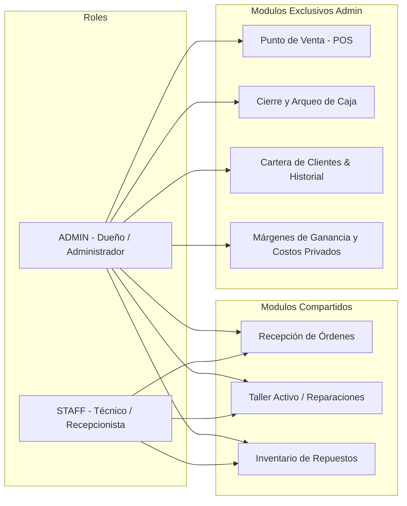
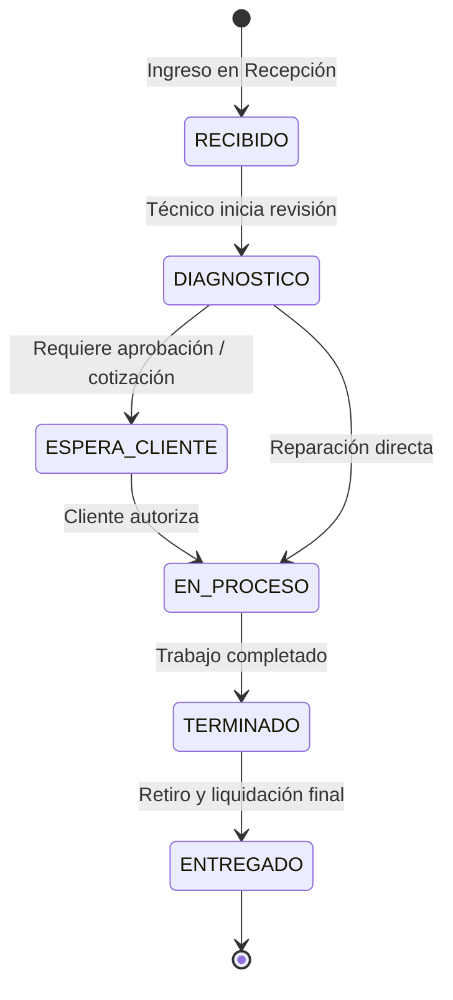

# 01. Modelo de Negocio y Dominio

## 1. Visión del Producto
**PhoneFix** es una solución integral de software diseñada para digitalizar, ordenar y potenciar la operación de talleres de reparación técnica de celulares y tiendas de accesorios/repuestos móviles.

El sistema fue diseñado pensando en las particularidades operativas del mercado latinoamericano, y específicamente de **Bolivia**:
* **Moneda nativa:** Bolivianos (Bs. / BOB).
* **Identificación:** Carnet de Identidad (CI / NIT con extensión de departamento).
* **Comunicación ágil:** Canales directos a WhatsApp móvil (`+591`) para avisos de presupuesto y finalización de reparaciones.
* **Dinámica comercial mixta:** Talleres que tienen stock propio de repuestos pero que también compran piezas por encargo a proveedores locales cercanos en el mercado informal/comercial.

---

## 2. Actores y Permisos (Sistema de Roles)

El sistema implementa dos roles principales diferenciados tanto a nivel de backend como de frontend:

### Rol: `STAFF` (Técnicos y Recepcionistas)
* **Recepción:** Recibir dispositivos de clientes, asentar la falla, dibujar el patrón de desbloqueo, registrar señas económicas y generar tickets de servicio.
* **Taller:** Visualizar la lista de dispositivos asignados o en cola, cambiar el estado del trabajo, agregar notas técnicas y registrar repuestos utilizados.
* **Inventario (Lectura/Consulta):** Ver disponibilidad de piezas y precios públicos de repuestos.

### Rol: `ADMIN` (Dueño del Negocio / Encargado de Tienda)
* Posee todos los permisos del rol `STAFF`.
* **Ventas (POS):** Cobro directo por mostrador de accesorios, protectores y repuestos sueltos.
* **Caja:** Control de la base inicial de caja, monitoreo de entradas (ventas + taller), registro de egresos/gastos y arqueo de caja diario.
* **Clientes:** Ver métricas de clientes (fidelización, gasto histórico, clasificación de clientes VIP o revendedores).
* **Costos y Finanzas:** Acceso al precio de costo real de los productos y cálculo de rentabilidad del stock.

---

## 3. Módulos y Flujos de Trabajo

### A. Recepción de Equipos y Registro de Orden
Es el punto de entrada de los dispositivos al negocio:
1. **Datos del Cliente:** Nombre completo, teléfono celular (WhatsApp) y CI/NIT opcional.
2. **Datos del Equipo:** Marca (Samsung, Apple, Xiaomi, Motorola, etc.), Modelo (ej. A50, iPhone 11, Redmi Note 9) y Color.
3. **Seguridad y Acceso al Dispositivo:** 
   * **Patrón de desbloqueo táctil interactivo:** Componente gráfico tipo Android (`PatternLock`) que graba la secuencia de 9 puntos.
   * **PIN numérico / Contraseña alfanumérica.**
4. **Inspección Física y Falla:** Falla declarada por el cliente y checklist de estado físico previo (Pantalla rota, mojado, no enciende, tapa rota, sin señal) para deslindar responsabilidades por daños previos.
5. **Aspecto Económico Inicial:** Precio estimado cotizado y monto dejado a cuenta/seña (en Bs.).

---

### B. Gestión de Taller (Workshop) y Ciclo de Vida de la Reparación
El ciclo de vida del dispositivo sigue una máquina de estados:

#### Imputación de Repuestos y Costos (Detalle Operativo Clave):
En la pantalla de detalle de reparación (`RepairDetailModal`), el técnico puede asociar repuestos con dos orígenes distintos:
1. **Origen Interno (`INTERNAL`):** El repuesto se toma del inventario del taller. Se conoce el costo interno y se carga al precio final del cliente.
2. **Origen Externo (`EXTERNAL`):** Repuesto comprado en la calle a un distribuidor o tienda externa:
   * Nombre del proveedor externo (`supplier`).
   * Costo real pagado por la pieza.
   * Precio a cobrar al cliente.
   * Estado de pago al proveedor (`isPaid`: si el taller ya liquidó la pieza al proveedor o la sacó a consignación/crédito).
3. **Mano de Obra (Labor Cost):** Cobro añadido por el servicio técnico.
4. **Notificación Instantánea por WhatsApp:** Botón que abre directamente la API de WhatsApp con un mensaje prefabricado para el cliente con el estado actual del equipo.

---

### C. Inventario y Control de Repuestos
* **Categorías:** `REPUESTO`, `ACCESORIO`, `HERRAMIENTA`, `OTRO`.
* **Doble precio:**
  * `costPrice`: Cuánto costó la pieza al negocio (protegido para administradores).
  * `salePrice`: Precio al público.
* **Control de Stock Mínimo:** Alerta visual de reabastecimiento cuando `stock <= minStock`.
* **KPIs en tiempo real:** Total de productos catalogados, capital invertido total (Sumatoria de `stock * costPrice`) y cantidad de ítems críticos.

---

### D. Punto de Venta (POS - Caja Rápida)
* Diseñado para la venta rápida de accesorios de mostrador (vidrios templados, cargadores, cables USB, fundas, audífonos).
* Buscador de productos en tiempo real.
* Carrito interactivo con modificación de cantidades al vuelo.
* Cálculo automático del total en Bs. y confirmación de pago (Efectivo o Tarjeta/Transferencia QR).

---

### E. Cierre de Caja Diario (Arqueo de Fondos)
Garantiza la cuadratura financiera al finalizar la jornada:
1. **Base Inicial:** Efectivo dejado en caja para cambio/sencillo.
2. **Entradas:**
   * Total recaudado por Ventas POS (+).
   * Total recaudado por Cobro de Reparaciones (+).
3. **Salidas / Gastos:**
   * Registro de compras de repuestos en la calle, insumos o gastos operativos diarios (-).
4. **Efectivo Esperado en Caja:**
   $$\text{Efectivo Esperado} = \text{Base Inicial} + \text{Ventas POS} + \text{Reparaciones} - \text{Gastos}$$
5. **Conteo Físico Real:** El encargado ingresa el monto físico contado en el cajón.
6. **Balance:** Muestra en tiempo real la diferencia (+ sobrante, - faltante o exacto).

---

### F. Cartera y Fidelización de Clientes
* Registro histórico de visitas y reparaciones por cliente.
* Métricas acumuladas: `totalRepairs` (cantidad de veces que trajo un celular) y `totalSpent` (monto total aportado al negocio).
* Identificador **VIP**: Para revendedores, empresas o clientes frecuentes a los que se les aplica atención o precios especiales.
* Búsqueda por Carnet (CI), Nombre o Números de Teléfono.
