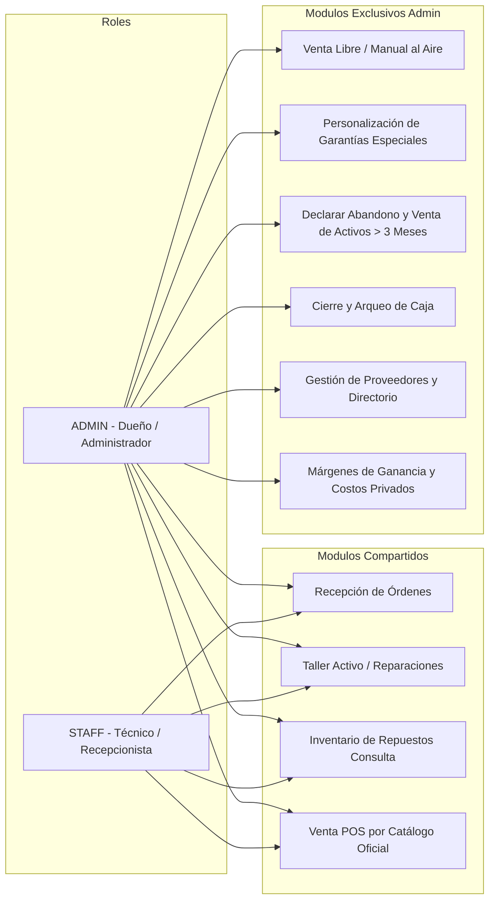
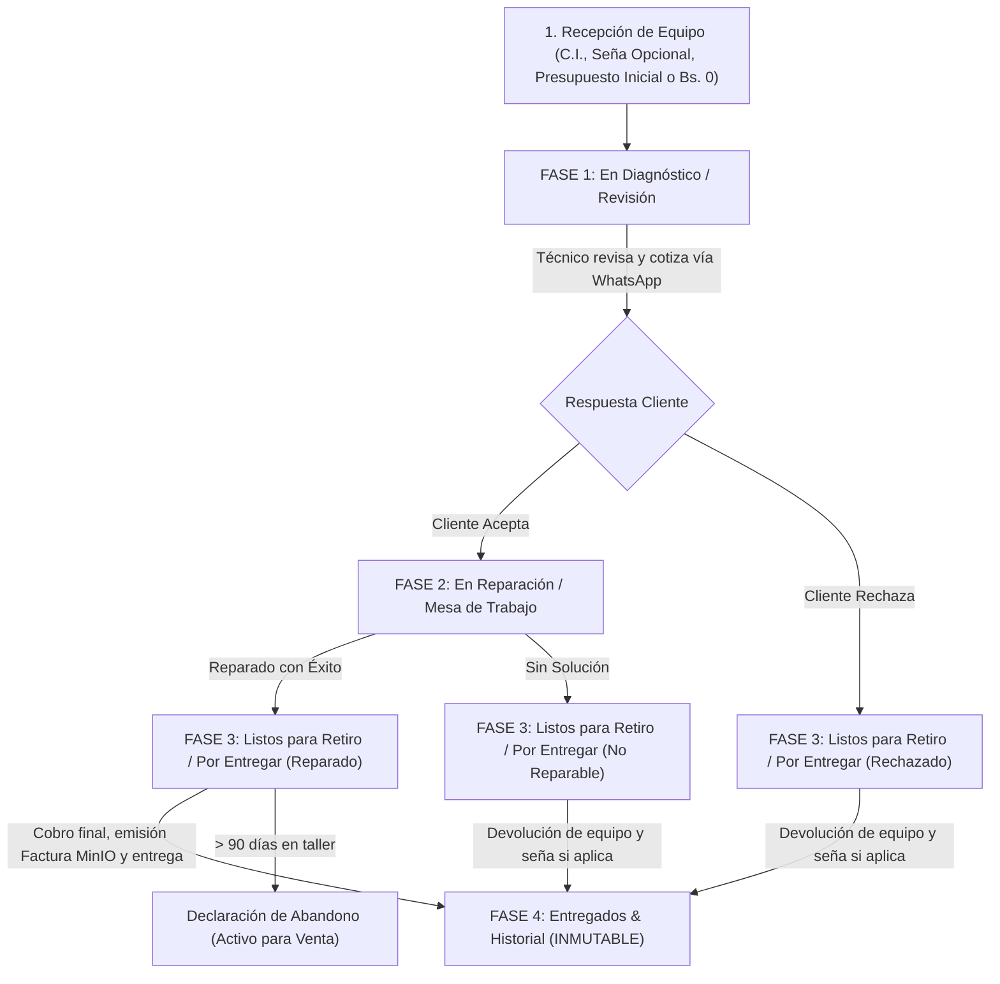

# 01. Modelo de Negocio y Dominio

## 1. Visión del Producto
**PhoneFix** es una solución integral de software diseñada para digitalizar, ordenar y potenciar la operación de talleres de reparación técnica de celulares y tiendas de accesorios/repuestos móviles.

El sistema está modelado a partir de la operación real del mercado boliviano (específicamente en **Montero / Santa Cruz**):
* **Moneda nativa:** Bolivianos (Bs. / BOB).
* **Identificación:** Carnet de Identidad (CI / NIT con extensión).
* **Canales de cobro:** Pagos bicanal en tiempo real (**Efectivo** y **QR bancario / Transferencia**), admitiendo pagos divididos.
* **Garantía comercial:** Garantía estándar predeterminada de **3 semanas** para cualquier trabajo técnico efectivamente reparado, computada a partir de la **fecha de retiro del equipo**, con flexibilidad total de personalización por parte de la administración.
* **Política de Abandono (Regla de 3 Meses):** Dispositivos no recogidos por más de 90 días pasan a ser activos del taller, sujetos a cambio de estado y venta libre por parte del Administrador a cualquier precio.
* **Almacenamiento de evidencias y comprobantes:** Integración con **MinIO** (Object Storage S3) para fotografías de estado físico del equipo, capturas de pagos QR y facturas/recibos en PDF.
* **Directorio de Proveedores y Casetas:** Registro de comercios externos locales (*Dr. Phone SCZ*, *Sandro*, *Señor GadDet*, *Arnold*, *Carlos*) con datos de mercado, caseta y contacto.

---

## 2. Actores y Permisos (Sistema de Roles)

---

## 3. Módulos y Flujos de Trabajo

### A. Recepción de Equipos y Registro de Orden
Punto de entrada técnico y legal del dispositivo:
1. **Datos del Cliente:**
   * Nombre completo y C.I.
   * **Celular principal (WhatsApp)**.
   * **Teléfono de Referencia (`Telf./Ref.`):** Segundo número de contacto esencial si el celular del cliente se queda apagado en el taller.
2. **Datos del Equipo:**
   * Marca (*Samsung*, *Apple*, *Xiaomi*, *Tecno*, *Infinix*, etc.), Modelo (*A12*, *13 Pro Max*, *Spark Go 1*) y Color.
   * **IMEI (Opcional):** El campo IMEI existe pero **no es obligatorio** (muchos equipos ingresan apagados o con display muerto).
   * **Seguridad de Acceso:** Patrón gráfico de 9 puntos (`PatternLock`) o PIN numérico.
3. **Inspección Física y Evidencia Fotográfica:**
   * Checklist físico previo (Pantalla rota, mojado, no enciende, tapa rota).
   * **Subida de Fotos a MinIO:** Respaldo visual del estado físico para evitar reclamos.
4. **Aspecto Económico Inicial:**
   * Presupuesto estimado cotizado.
   * Monto a cuenta / seña (registrado en Efectivo o QR).
   * Fecha de entrega prometida.

---

### B. Gestión de Taller en 4 Fases Operativas y Control de Presupuesto

El flujo de trabajo técnico y de custodia se organiza formalmente en **4 fases operativas**:

#### Reglas de Negocio en Taller:

1. **Garantía del Trabajo:**
   * **Condición de activación:** Solo se otorga si el equipo fue **efectivamente REPARADO**. Si no se arregló, la garantía es NULA.
   * **Plazo predeterminado:** **`3 semanas` fijo** de forma automática.
   * **Cómputo temporal:** Corre estrictamente a partir de la **Fecha de Retiro / Entrega en mano del cliente**.
   * **Excepciones de Administración:** El Administrador puede modificarla a `SIN GARANTIA` (para placas mojadas/térmicas), `3 MESES` (pantallas OLED/originales) o días personalizados.

2. **Control de Presupuesto y Techo Presupuestario (Budget Cap):**
   * El presupuesto acordado (`estimated_total`) es el monto tope aprobado por el cliente.
   * Cada repuesto cargado tiene su costo real (`cost`) y precio al cliente (`price`).
   * La interfaz previene que los gastos excedan el presupuesto acordado con alertas visuales de auditoría.

3. **Política de Abandono (> 3 Meses) y Absorción como Activo:**
   * Si un equipo permanece en custodia del taller por **más de 90 días (3 meses)** sin ser retirado por el cliente:
     * El sistema muestra una alerta destacada: *"Equipo con plazo vencido (> 90 días)"*.
     * **Autorización Estricta:** Se requiere que el **Administrador** autorice y cambie el estado a `DECLARADO_ABANDONO`.
     * **Conversión en Activo Comercial:** Una vez cambiado el estado, el teléfono pasa a ser legal y contablemente parte de los **activos del taller**.
     * **Venta Libre:** El mismo Administrador tiene la potestad de publicarlo a la venta en el POS o tienda **a cualquier precio que decida**.

4. **Discriminación del Canal de Egreso en Compras a Casetas:**
   * Al comprar un repuesto externo a caseta, se registra si se pagó en **Efectivo (Caja Chica)** o por **QR / Transferencia Bancaria**. Esto garantiza que la gaveta física no sufra descuadres si la compra se pagó desde la cuenta bancaria.

5. **Clientes Recurrentes por C.I.:**
   * El sistema detecta clientes frecuentes mediante su número de C.I., calculando el contador correlativo de visitas (`repairs_count`) y otorgando la distinción de cliente recurrente para fidelización.

---

### C. Directorio y Formulario de Proveedores (`Supplier`)

Para reflejar la dinámica de compras de repuestos en centros comerciales y mercados (Comercial Chiriguano, Montero, La Ramada):

* **Nombre de la Tienda o Proveedor:** **Único campo obligatorio**. Este es el que se muestra en el desplegable de compras de taller.
* **Campos Opcionales Enriquecedores (Editables):**
  * **Lugar / Mercado:** Ej. *"Comercial Chiriguano"*, *"Mercado Central Montero"*.
  * **Nº de Caseta / Local / Pasillo:** Ej. *"Caseta #14, Pasillo B"*.
  * **Dirección exacta:** Texto libre.
  * **Nombre del Técnico / Encargado de Tienda:** Persona de contacto directo.
  * **Celular / WhatsApp de Referencia:** Enlace directo para consultar stock y precios por chat.
  * **Especialidad o Notas:** Ej. *"Trae repuestos de iPhone y pantallas OLED"*.
* **Creación Ágil:** Al registrar un repuesto en taller, si el proveedor no está en la lista, se cuenta con un botón `+ Nuevo Proveedor` que abre un formulario rápido sin abandonar la orden.

---

### D. Estrategia de Inventario Progresivo (Venta Libre vs Stock Estricto)

Para evitar frenar la operación diaria:

1. **Fase Inicial (Inventario Inactivo para Control de Stock):**
   * El sistema no bloquea ventas por stock cero.
   * **Venta Libre al Aire (Exclusiva ADMIN):** El Administrador puede ingresar productos manuales, servicios express o precios libres tiroteados al instante. Los empleados `STAFF` solo pueden vender artículos catalogados.
   * **Poblamiento Orgánico:** Cada venta manual permite marcar `[x] Guardar en catálogo` para ir construyendo el inventario real a partir de las ventas diarias.
2. **Fase Futura (Inventario Físico Activo):**
   * Una vez contadas las existencias, se activa el control estricto de unidades y las alertas de stock bajo. La venta libre permanece en segundo plano reservada al Administrador.

---

### E. Cobro Bicanal (Efectivo y QR) y Arqueo de Caja

* Toda orden o venta admite desglose simultáneo:
  * **Monto en Efectivo (`payment_cash`):** Dinero físico en cajón.
  * **Monto por QR / Transferencia (`payment_qr`):** Dinero acreditado en banco.
* **Arqueo Diario Separado:**
  1. **Caja Física:** $\text{Base} + \text{Ventas Efectivo} + \text{Reparaciones Efectivo} - \text{Salidas Caja Chica}$. Se contrasta contra el dinero contado en mano.
  2. **Caja Virtual:** $\text{Ventas QR} + \text{Reparaciones QR}$. Se contrasta contra el extracto de la app bancaria.
