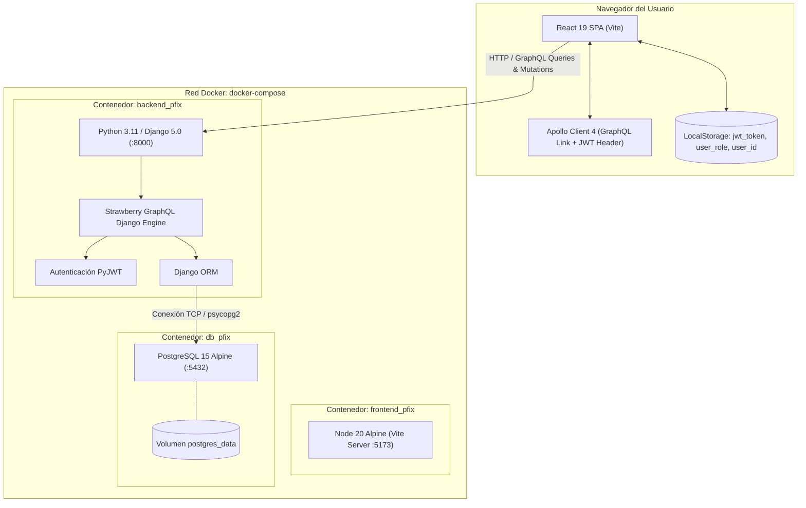
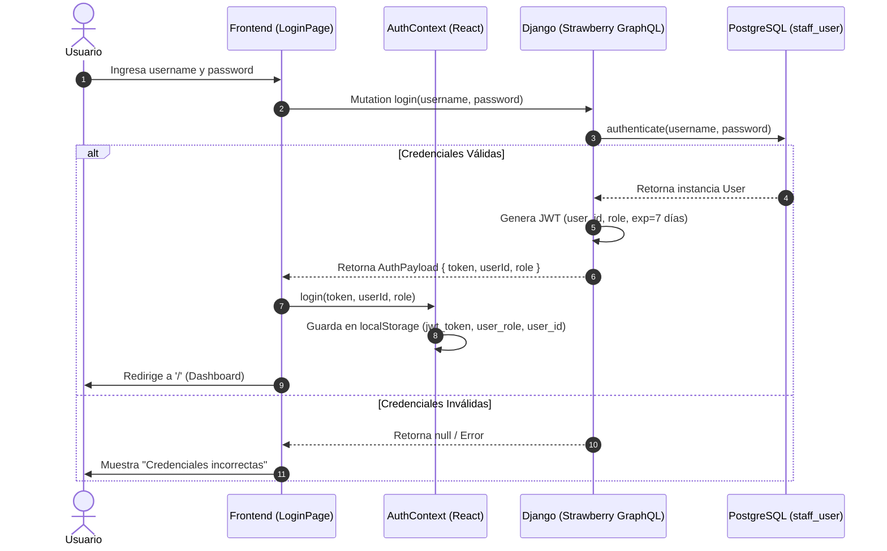

# 02. Arquitectura y Tecnologías

## 1. Diagrama de Arquitectura del Sistema

El sistema implementa una arquitectura desacoplada **Cliente-Servidor (SPA + API GraphQL)** completamente contenerizada en Docker:



---

## 2. Stack Tecnológico

### Frontend
| Componente | Tecnología | Versión / Detalle | Razón de Uso |
| :--- | :--- | :--- | :--- |
| **Framework Base** | React | `^19.2.0` | React moderno con concurrencia, Hooks y alto rendimiento. |
| **Lenguaje** | TypeScript | `~5.9.3` | Tipado estático para modelos de cliente, taller, inventario y ventas. |
| **Bundler** | Vite | `^7.3.1` | Compilación ultrarrápida y Hot Module Replacement (HMR). |
| **Estilos** | Tailwind CSS | `^4.1.18` (vía `@tailwindcss/postcss`) | Sistema de diseño atómico, minimalista y responsivo. |
| **Enrutamiento** | React Router DOM | `^7.13.0` | Gestión de rutas SPA, layouts anidados y guards de protección. |
| **Cliente API** | Apollo Client | `^4.1.4` (y `graphql ^16.12.0`) | Consumo eficiente de esquemas GraphQL con inyección de JWT por headers. |
| **Iconografía** | Lucide React | `^0.564.0` | Set de iconos vectoriales modernos y consistentes. |

---

### Backend
| Componente | Tecnología | Versión / Detalle | Razón de Uso |
| :--- | :--- | :--- | :--- |
| **Lenguaje** | Python | `3.11-slim` | Rendimiento óptimo y soporte nativo tipado moderno. |
| **Framework Web** | Django | `>=5.0, <6.0` | ORM robusto, sistema de migraciones, panel administrativo y seguridad. |
| **Motor GraphQL** | Strawberry GraphQL | `strawberry-graphql-django` | GraphQL moderno basado en `dataclasses` y type annotations de Python. |
| **Motor de BD** | PostgreSQL | `15-alpine` | Base de datos relacional ACID para transaccionalidad de caja y stock. |
| **Driver de BD** | `psycopg2-binary` | Driver nativo para PostgreSQL. | Conexión directa Django ORM - PostgreSQL. |
| **Autenticación** | `PyJWT` | `>=2.8.0` | Generación y validación de tokens JWT sin estado. |
| **Variables de Entorno**| `django-environ` | Lectura de `.env` estructurado. | Configuración 12-Factor App. |
| **CORS** | `django-cors-headers` | Control de orígenes cruzados. | Permite peticiones desde el frontend local y remoto. |

---

## 3. Seguridad y Flujo de Autenticación

El flujo de autenticación es completamente Stateless basado en **JSON Web Tokens (JWT)**:



### Inyección de Token en Peticiones Posteriores
* En cada petición que realiza `Apollo Client` (`src/lib/apolloClient.ts`), el enlace `authLink` intercepta los headers:
  ```typescript
  const token = localStorage.getItem('jwt_token');
  headers: {
    ...headers,
    authorization: token ? `Bearer ${token}` : "",
  }
  ```
* En el backend (`core/auth_graphql.py`), la función utilitaria `get_user_from_jwt(request)` decodifica el token con la clave secreta `JWT_SECRET_KEY` y obtiene el usuario autenticado desde `staff.models.User`.

### Protección de Rutas en Frontend
1. **`ProtectedRoute.tsx`:** Verifica si el usuario posee sesión (`isAuthenticated`). Si no, redirige inmediatamente a `/login`.
2. **`AdminOnlyRoute.tsx`:** Verifica si `user.role === 'ADMIN'`. Si un usuario con rol `STAFF` intenta ingresar a `/ventas`, `/caja` o `/clientes`, es denegado o redirigido al inicio del panel.

---

## 4. Red y Configuración de Docker

El archivo `docker-compose.yml` orquesta 3 servicios interconectados en la misma red:

```yaml
services:
  db_pfix:         # Puerto 5432:5432 - Persistencia con volumen 'postgres_data'
  backend_pfix:    # Puerto 8000:8000 - Montaje de volumen local para hot-reload
  frontend_pfix:   # Puerto 5173:5173 - Servidor Vite con host 0.0.0.0
```

### Puertos Expuestos
* **8000:** Django Backend API (`/graphql/` y `/admin/`).
* **5173:** Vite Frontend React (`http://localhost:5173`).
* **5432:** PostgreSQL Database.
