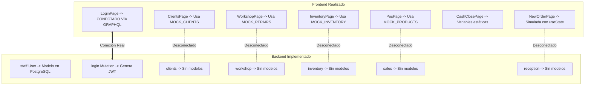

# 04. Situación Actual y Diagnóstico del Código

Tras una auditoría completa del código después de 6 meses de inactividad (último commit del 11 de abril de 2026), se presenta el estado de situación, el desfase entre capas y las deudas técnicas detectadas.

---

## 1. Resumen de Estado

| Componente | Nivel de Avance | Estado Real |
| :--- | :--- | :--- |
| **Infraestructura Docker** | 90% | Contenedores operativos para Postgres, Backend y Frontend. |
| **Autenticación (JWT + GraphQL)**| 85% | Login funcional entre React y Django Strawberry GraphQL. |
| **UI / UX (Frontend)** | 80% | Pantallas, modales y navegación construidos con alta calidad visual. |
| **Modelos de Datos (Backend)** | 15% | Solo existe `staff.User`. El resto de apps están vacías. |
| **API GraphQL (Backend)** | 20% | Solo existen query `hello` y mutación `login`. |
| **Conexión Frontend - Backend** | 20% | Solo el Login está conectado; el resto opera con Mocks. |

---

## 2. El Desfase Arquitectónico ("The Gap")

El proyecto experimentó un avance acelerado en el **diseño de interfaz y experiencia de usuario (Frontend)** antes de que los modelos del **Backend** fueran completados.



---

## 3. Radiografía por Capas

### A. Capa Backend (`phone-fix-backend`)
* **Lo que está funcionando:**
  * Dockerfile con Python 3.11 y dependencias instaladas.
  * Modelo `staff.User` extendiendo `AbstractUser` con los roles `ADMIN` y `STAFF`.
  * Generación y validación de tokens JWT mediante `PyJWT`.
  * Esquema de Strawberry GraphQL exponiendo `hello` y `login`.
* **Lo que está pendiente:**
  * `clients/models.py`: Sin tablas de Clientes ni Teléfonos.
  * `inventory/models.py`: Sin tablas de Productos, Categorías ni Stock.
  * `reception/models.py` y `workshop/models.py`: Sin tablas de Órdenes de Servicio, Dispositivos ni Partes/Repuestos asignados.
  * `sales/models.py`: Sin tablas de Ventas mostrador, Ítems de venta ni Cierres de caja diarios.
  * `core/schema.py`: Sin queries (`allClients`, `allRepairs`, `allProducts`) ni mutations (`createRepairOrder`, `updateRepairStatus`, `createProduct`, etc.).

---

### B. Capa Frontend (`phone-fix-frontend`)
* **Lo que está funcionando:**
  * La pantalla de inicio de sesión (`LoginPage`) se conecta al backend mediante Apollo Client y almacena el JWT en `localStorage`.
  * El sistema de rutas (`react-router-dom`) valida la sesión y restringe las vistas de administración (`/ventas`, `/caja`, `/clientes`).
  * Las interfaces están completamente diseñadas:
    * Selector interactivo de patrón táctil para Android (`PatternLock`).
    * Modal de detalle técnico con pestañas de costos, WhatsApp y asignación de piezas (`RepairDetailModal`).
    * Selector dinámico entre repuesto interno de almacén y compra externa a proveedor (`AddLineItemModal`).
    * Catálogo interactivo de Punto de Venta (POS) con carrito y cálculo de totales.
    * Módulo de arqueo y cierre de caja con cálculo de diferencias y balance.
* **Lo que está pendiente:**
  * Reemplazar los arrays estáticos (`MOCK_REPAIRS`, `MOCK_INVENTORY`, `MOCK_CLIENTS`, `MOCK_PRODUCTS`) por hooks `useQuery` y `useMutation` de `@apollo/client`.

---

## 4. Deudas Técnicas y Desalineaciones Detectadas

1. **Nombre erróneo de archivo de entorno:**
   * Existe `phone-fix-frontend/.env.developmen` (le falta la **t** al final para ser reconocido por Vite como `.env.development`).
2. **URL del backend quemada (Hardcoded) en Frontend:**
   * En `phone-fix-frontend/src/lib/apolloClient.ts`, la variable `uri` está fija a la IP remota:
     ```typescript
     uri: 'http://95.111.245.9:8000/graphql/',
     ```
     En lugar de utilizar:
     ```typescript
     uri: import.meta.env.VITE_API_URL || 'http://localhost:8000/graphql/',
     ```
3. **Desalineación de Zona Horaria:**
   * En `phone-fix-backend/core/settings.py` se tiene configurado `TIME_ZONE = "America/Caracas"`, mientras que el sistema fue concebido con formatos de moneda y teléfono de Bolivia (`America/La_Paz`).
4. **Almacenamiento de fotos de recepción:**
   * En la vista de recepción (`NewOrderPage`) existe el botón "Adjuntar Fotos", pero el backend aún no tiene configurado `django-storages` ni directorio de subida para archivos estáticos/media (`MEDIA_ROOT` y `MEDIA_URL`).
