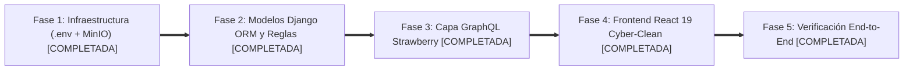

# 05. Roadmap y Plan de Reactivación

Este documento establece la hoja de ruta técnica histórica y el registro de finalización de todas las fases de reactivación del sistema **PhoneFix**, reflejando la operación real del mercado de Montero y Santa Cruz.

---

## 🎯 Plan de Fases (100% COMPLETADO)

---

## Fase 1: Infraestructura Central y Entornos (.env + MinIO)
*(Estado: **COMPLETADA**)*
* ✅ `.env` maestro en la raíz (`d:\proyectoPF\.env`) y `.env.example` creados.
* ✅ Contenedor `minio_pfix` (puertos 9000 y 9001) añadido a `docker-compose.yml` con alias de red `minio`.
* ✅ Bucket privado `phonefix-media` creado para comprobantes y fotografías.
* ✅ Variables de Apollo Client dinamizadas con `import.meta.env.VITE_API_URL`.
* ✅ Corrección del archivo `.env.development` y limpieza de variables quemadas.

---

## Fase 2: Modelado de Datos en Django ORM (Consistente y Completo)
*(Estado: **COMPLETADA**)*

Implementación de modelos con las reglas de negocio reales confirmadas:

### 1. App `clients` (`clients/models.py`)
* ✅ Modelo `Client` con soporte para C.I., Celular WhatsApp y Teléfono de referencia familiar.
* ✅ Unicidad por C.I. y teléfono en mutaciones para evitar duplicados.
* ✅ Métricas de fidelización: contador correlativo de visitas (`repairs_count`) y badge de recurrencia (`is_recurrent`).

### 2. App `inventory` (`inventory/models.py`)
* ✅ Modelo `Product` con categorías (`REPUESTO`, `ACCESORIO`, `HERRAMIENTA`, `SERVICIO`).
* ✅ Estrategia de inventario progresivo: soporte para venta libre al aire y control de existencias opcional (`is_stock_managed`).
* ✅ Catálogo de presets de marcas y modelos populares en Bolivia.

### 3. App `workshop` (`workshop/models.py`)
* ✅ Modelo `Supplier` para directorio de tiendas y casetas locales (Chiriguano, La Ramada, Montero).
* ✅ Modelo `Device` con patrón táctil de 9 puntos (`passcode`) y checklist físico de recepción.
* ✅ Modelo `RepairOrder` unificando cotización estimada, señas bicanal (`deposit_cash`, `deposit_qr`), saldos finales, política de abandono (> 90 días), comprobante en MinIO y canal de devolución (`deposit_refund_method`).
* ✅ Modelo `RepairPartItem` con discriminación de canal de egreso (`payment_method`: `EFECTIVO` vs `QR`).

### 4. App `sales` (`sales/models.py`)
* ✅ Modelo `Sale` y `SaleItem` con venta manual fuera de catálogo y opción `save_to_catalog`.
* ✅ Modelo `CashClose` para arqueo diario de caja conciliando gaveta física y extracto de app bancaria QR.

---

## Fase 3: Capa GraphQL con Strawberry
*(Estado: **COMPLETADA**)*
* ✅ Resolvers completos para `registerRepairOrder`, `updateRepairStatus`, `declareAbandonment` y `deliverRepairOrder`.
* ✅ Mutación `updateRepairQuote` para cotización diferida (post-desarmado).
* ✅ Mutaciones CRUD para directorio de casetas y proveedores (`create_supplier`, `update_supplier`, `delete_supplier`).
* ✅ Mutación `addRepairPart` con imputación de canal de pago y control de presupuesto aprobado.
* ✅ Mutación `refundRepairDeposit` con soporte para reintegros en efectivo o vía QR bancario.
* ✅ Mutación `generateRepairInvoice` generando facturas PDF mediante ReportLab y subida a MinIO.
* ✅ Resolver inmutable `accounting_ledger` consolidando ingresos y egresos de taller y mostrador.

---

## Fase 4: Frontend React 19 (Dark Cyber-Clean)
*(Estado: **COMPLETADA**)*
* ✅ Paleta oficial Cyber-Clean (Fondo `#080B11`, Cian `#00E5FF`, Esmeralda `#10B981`, Ámbar `#F59E0B`).
* ✅ `MainLayout` optimizado para pantallas completas, anchos extendidos y sin cortes de texto.
* ✅ `NewOrderPage`: Recepción con autocompletado en vivo de clientes por C.I. y presets de marcas.
* ✅ `WorkshopPage`: Reestructurada en **4 fases operativas**:
  1. *En Diagnóstico / Revisión*
  2. *En Reparación / Mesa de Trabajo*
  3. *Listos para Retiro / Por Entregar*
  4. *Entregados & Historial*
* ✅ `RepairDetailModal` & `AddLineItemModal`: Barra de auditoría de techo presupuestario (`Budget Cap`), selector de canal de compra (`Efectivo` vs `QR`) y liquidación con emisión de factura PDF.
* ✅ `AccountingLedgerPage`: 5 Tarjetas KPI bicanal con saldos independientes para gaveta física y banco QR, 11 columnas detalladas y exportación a Excel UTF-8 BOM.
* ✅ `ClientsPage`: Directorio interactivo con contador de órdenes correlativo y badge `⭐ Cliente Recurrente`.

---

## Fase 5: Pruebas y Verificación End-to-End
*(Estado: **COMPLETADA**)*
* ✅ Migraciones aplicadas en PostgreSQL mediante `docker compose exec backend_pfix python manage.py migrate`.
* ✅ Compilación limpia sin cachés ejecutada con `docker compose up -d --build`.
* ✅ Pruebas visuales automatizadas con agente de navegador verificando login, detección de C.I., fases de taller, selector de egresos y libro contable bicanal.
