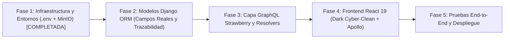

# 05. Roadmap y Plan de Reactivación

Este documento establece la hoja de ruta técnica actualizada y los modelos de datos ajustados para reflejar la operación real de PhoneFix (basada en el cuaderno de recepción de ASOTTECMO, el registro de ingresos en Excel, las políticas de abandono > 3 meses y la integración con **MinIO**).

---

## 🎯 Plan de Fases



---

## Fase 1: Infraestructura Central y Entornos (.env + MinIO)
*(Estado: **COMPLETADA** tras la reorganización)*
* `.env` maestro en la raíz (`d:\proyectoPF\.env`) y `.env.example` creados.
* Contenedor `minio_pfix` (puertos 9000 y 9001) añadido a `docker-compose.yml`.
* Variables de Apollo Client dinamizadas con `import.meta.env.VITE_API_URL`.
* Corrección del archivo `.env.development` y limpieza de residuales.

---

## Fase 2: Modelado de Datos en Django ORM (Consistente y Completo)
*Duración estimada: 1 a 2 días*

Implementar los modelos con las reglas de negocio reales confirmadas:

### 1. App `clients` (`clients/models.py`)
```python
from django.db import models

class Client(models.Model):
    full_name = models.CharField(max_length=150, verbose_name="Nombres y Apellidos")
    ci = models.CharField(max_length=30, blank=True, null=True, verbose_name="C.I. / NIT")
    phone_primary = models.CharField(max_length=20, verbose_name="Celular Principal (WhatsApp)")
    phone_reference = models.CharField(max_length=20, blank=True, null=True, verbose_name="Teléfono de Referencia")
    is_vip = models.BooleanField(default=False, verbose_name="Cliente VIP / Revendedor")
    notes = models.TextField(blank=True, null=True, verbose_name="Observaciones de fidelización")
    created_at = models.DateTimeField(auto_now_add=True)

    def __str__(self):
        return f"{self.full_name} ({self.ci or 'Sin CI'})"
```

---

### 2. App `inventory` (`inventory/models.py`)
```python
from django.db import models

class Product(models.Model):
    class Category(models.TextChoices):
        REPUESTO = 'REPUESTO', 'Repuesto'
        ACCESORIO = 'ACCESORIO', 'Accesorio'
        HERRAMIENTA = 'HERRAMIENTA', 'Herramienta'
        SERVICIO = 'SERVICIO', 'Servicio Técnico Express'
        OTRO = 'OTRO', 'Otro'

    name = models.CharField(max_length=200, verbose_name="Nombre del Producto")
    category = models.CharField(max_length=20, choices=Category.choices, default=Category.ACCESORIO)
    cost_price = models.DecimalField(max_digits=10, decimal_places=2, default=0, verbose_name="Costo (Caja Chica)")
    sale_price = models.DecimalField(max_digits=10, decimal_places=2, verbose_name="Precio de Venta al Público")
    
    # Flags para Inventario Progresivo (Inactivo inicialmente para control de existencias)
    is_stock_managed = models.BooleanField(default=False, verbose_name="¿Controlar existencias estrictas?")
    stock = models.IntegerField(default=0, verbose_name="Existencias actuales")
    min_stock = models.IntegerField(default=2, verbose_name="Alerta de Stock Mínimo")
    location = models.CharField(max_length=100, blank=True, null=True, verbose_name="Ubicación física en tienda")
    created_at = models.DateTimeField(auto_now_add=True)

    def __str__(self):
        return f"{self.name} - Bs. {self.sale_price}"
```

---

### 3. App `workshop` (`workshop/models.py`)
Unifica el ciclo completo (Recepción, Taller, Custodia, Abandono y Proveedores):

```python
from django.db import models
from django.utils import timezone
from datetime import timedelta

class Supplier(models.Model):
    """Directorio de proveedores y casetas (Montero, Chiriguano, La Ramada, etc.)"""
    name = models.CharField(max_length=100, unique=True, verbose_name="Nombre de la Tienda / Proveedor (Obligatorio)")
    is_internal = models.BooleanField(default=False, verbose_name="¿Es stock propio de PhoneFix?")
    market_place = models.CharField(max_length=100, blank=True, null=True, verbose_name="Lugar o Mercado (Ej: Chiriguano)")
    booth_number = models.CharField(max_length=50, blank=True, null=True, verbose_name="Nº de Caseta / Pasillo")
    address = models.CharField(max_length=150, blank=True, null=True, verbose_name="Dirección física")
    contact_name = models.CharField(max_length=100, blank=True, null=True, verbose_name="Nombre del Técnico / Encargado")
    phone_reference = models.CharField(max_length=20, blank=True, null=True, verbose_name="Celular / WhatsApp de Referencia")
    notes = models.TextField(blank=True, null=True, verbose_name="Especialidad o Notas (Ej: Pantallas OLED)")
    created_at = models.DateTimeField(auto_now_add=True)

    def __str__(self):
        return f"{self.name} ({self.market_place or 'Local'})"

class Device(models.Model):
    brand = models.CharField(max_length=50, verbose_name="Marca")
    model = models.CharField(max_length=100, verbose_name="Modelo")
    color = models.CharField(max_length=50, blank=True, null=True)
    
    # IMEI: Opcional por definición del negocio
    imei = models.CharField(max_length=30, blank=True, null=True, verbose_name="IMEI (Opcional)")
    imei_printed = models.CharField(max_length=30, blank=True, null=True, verbose_name="IMEI Impreso")
    
    passcode = models.CharField(max_length=100, blank=True, null=True, verbose_name="Patrón de 9 puntos o PIN")
    physical_condition = models.JSONField(default=list, verbose_name="Detalles físicos (Pantalla rota, mojado...)")

class RepairOrder(models.Model):
    class Status(models.TextChoices):
        RECIBIDO = 'RECIBIDO', 'Recibido en Recepción'
        DIAGNOSTICO = 'DIAGNOSTICO', 'En Diagnóstico'
        ESPERA_CLIENTE = 'ESPERA_CLIENTE', 'Esperando Autorización de Presupuesto'
        EN_PROCESO = 'EN_PROCESO', 'En Reparación'
        REPARADO_ESPERA = 'REPARADO_ESPERA', 'Reparado (En Espera de Retiro)'
        NO_REPARABLE_ESPERA = 'NO_REPARABLE_ESPERA', 'Sin Solución (En Espera de Retiro)'
        RECHAZADO_ESPERA = 'RECHAZADO_ESPERA', 'Presupuesto Rechazado (En Espera de Retiro)'
        ENTREGADO_REPARADO = 'ENTREGADO_REPARADO', 'Entregado al Cliente (Reparado)'
        ENTREGADO_SIN_REPARAR = 'ENTREGADO_SIN_REPARAR', 'Devuelto al Cliente (Sin Reparar)'
        DECLARADO_ABANDONO = 'DECLARADO_ABANDONO', 'Declarado Abandono (> 3 Meses - Activo del Taller)'

    class WarrantyPeriod(models.TextChoices):
        THREE_WEEKS = '3_SEMANAS', '3 Semanas (Estándar)'
        TWO_WEEKS = '2_SEMANAS', '2 Semanas'
        ONE_MONTH = '1_MES', '1 Mes'
        THREE_MONTHS = '3_MESES', '3 Meses (Pantallas OLED / Original)'
        NO_WARRANTY = 'SIN_GARANTIA', 'Sin Garantía'
        CUSTOM = 'PERSONALIZADO', 'Personalizado'

    ticket_number = models.CharField(max_length=20, unique=True, verbose_name="Nº de Ticket Correlativo")
    client = models.ForeignKey('clients.Client', on_delete=models.PROTECT, related_name='repairs')
    device = models.OneToOneField(Device, on_delete=models.CASCADE)
    
    # Falla, Diagnóstico y Observaciones
    issue_description = models.TextField(verbose_name="Falla declarada por cliente")
    technician_notes = models.TextField(blank=True, null=True, verbose_name="Diagnóstico técnico")
    tech_observations = models.CharField(max_length=255, blank=True, null=True, verbose_name="Observaciones (Ej: Transplante de EPROM)")

    # Garantía (3 semanas por defecto si se repara, corre desde fecha de retiro)
    warranty = models.CharField(max_length=20, choices=WarrantyPeriod.choices, default=WarrantyPeriod.THREE_WEEKS)
    warranty_custom_notes = models.CharField(max_length=100, blank=True, null=True)
    warranty_expires_at = models.DateField(blank=True, null=True, verbose_name="Fecha de Vencimiento de Garantía")

    # Proveedor del repuesto principal
    supplier = models.ForeignKey(Supplier, on_delete=models.SET_NULL, null=True, blank=True)

    # --- Finanzas Trazables (Diferenciando Seña de Saldo Final) ---
    estimated_total = models.DecimalField(max_digits=10, decimal_places=2, default=0, verbose_name="Presupuesto Total Cotizado")
    
    # Anticipo / Seña (Al ingresar)
    deposit_cash = models.DecimalField(max_digits=10, decimal_places=2, default=0, verbose_name="Seña en Efectivo")
    deposit_qr = models.DecimalField(max_digits=10, decimal_places=2, default=0, verbose_name="Seña por QR")
    deposit_refunded = models.DecimalField(max_digits=10, decimal_places=2, default=0, verbose_name="Seña Devuelta si no tuvo arreglo")
    deposit_date = models.DateTimeField(blank=True, null=True, verbose_name="Fecha del Pago de Seña")

    # Saldo Final (Al retirar)
    final_payment_cash = models.DecimalField(max_digits=10, decimal_places=2, default=0, verbose_name="Saldo Final Efectivo")
    final_payment_qr = models.DecimalField(max_digits=10, decimal_places=2, default=0, verbose_name="Saldo Final QR")

    # Costos de Caja Chica y Ganancia Neta
    cost_cash_out = models.DecimalField(max_digits=10, decimal_places=2, default=0, verbose_name="Salida de Caja Chica (Costo Repuesto)")
    profit = models.DecimalField(max_digits=10, decimal_places=2, default=0, verbose_name="Ganancia Neta")

    status = models.CharField(max_length=30, choices=Status.choices, default=Status.RECIBIDO)

    # --- Política de Abandono (> 3 Meses / 90 Días) ---
    is_abandoned = models.BooleanField(default=False, verbose_name="¿Declarado en abandono?")
    abandoned_at = models.DateTimeField(blank=True, null=True, verbose_name="Fecha de Declaración de Abandono")
    abandoned_authorized_by = models.ForeignKey('staff.User', on_delete=models.SET_NULL, null=True, blank=True, related_name='abandoned_authorizations')
    abandonment_sale_price = models.DecimalField(max_digits=10, decimal_places=2, blank=True, null=True, verbose_name="Precio de Venta como Activo")
    
    # --- Referencias MinIO (S3 Presigned Keys) ---
    initial_photo_key = models.CharField(max_length=255, blank=True, null=True, verbose_name="Clave MinIO Foto Recepción")
    payment_qr_receipt_key = models.CharField(max_length=255, blank=True, null=True, verbose_name="Clave MinIO Comprobante QR")

    delivery_promise_date = models.DateField(blank=True, null=True, verbose_name="Fecha prometida de entrega")
    created_at = models.DateTimeField(auto_now_add=True)
    delivered_at = models.DateTimeField(blank=True, null=True, verbose_name="Fecha y Hora Real de Entrega / Retiro")

    def total_collected(self):
        """Total efectivamente pagado por el cliente"""
        return (self.deposit_cash + self.deposit_qr + self.final_payment_cash + self.final_payment_qr) - self.deposit_refunded

    def calculate_profit(self):
        """Ganancia neta: Total cobrado - Costo pagado en caja chica"""
        return self.total_collected() - self.cost_cash_out
```

---

### 4. App `sales` (`sales/models.py`)
Ventas de mostrador con soporte para Venta Manual al Aire (Exclusiva ADMIN) y arqueo bicanal:

```python
from django.db import models

class Sale(models.Model):
    user = models.ForeignKey('staff.User', on_delete=models.PROTECT)
    payment_cash = models.DecimalField(max_digits=10, decimal_places=2, default=0, verbose_name="Pago en Efectivo")
    payment_qr = models.DecimalField(max_digits=10, decimal_places=2, default=0, verbose_name="Pago en QR")
    total = models.DecimalField(max_digits=10, decimal_places=2, verbose_name="Total Cobrado")
    receipt_minio_key = models.CharField(max_length=255, blank=True, null=True, verbose_name="Comprobante en MinIO")
    created_at = models.DateTimeField(auto_now_add=True)

class SaleItem(models.Model):
    sale = models.ForeignKey(Sale, related_name='items', on_delete=models.CASCADE)
    product = models.ForeignKey('inventory.Product', null=True, blank=True, on_delete=models.SET_NULL)
    
    # Venta Libre al Aire (Exclusiva ADMIN)
    is_manual_entry = models.BooleanField(default=False, verbose_name="¿Es venta manual fuera de catálogo?")
    custom_name = models.CharField(max_length=200, blank=True, null=True, verbose_name="Descripción del ítem manual")
    save_to_catalog = models.BooleanField(default=False, verbose_name="¿Poblar este ítem en el catálogo?")
    
    quantity = models.PositiveIntegerField(default=1)
    unit_price = models.DecimalField(max_digits=10, decimal_places=2)
    unit_cost = models.DecimalField(max_digits=10, decimal_places=2, default=0, verbose_name="Costo aproximado (Caja Chica)")

class CashClose(models.Model):
    date = models.DateField(auto_now_add=True)
    initial_cash = models.DecimalField(max_digits=10, decimal_places=2, verbose_name="Base de Efectivo Inicial")
    
    # Entradas Efectivo vs QR
    sales_cash = models.DecimalField(max_digits=10, decimal_places=2, default=0)
    sales_qr = models.DecimalField(max_digits=10, decimal_places=2, default=0)
    repairs_cash = models.DecimalField(max_digits=10, decimal_places=2, default=0) # Suma de señas y saldos en efectivo
    repairs_qr = models.DecimalField(max_digits=10, decimal_places=2, default=0)   # Suma de señas y saldos en QR
    
    # Salidas y Devoluciones
    expenses_cash = models.DecimalField(max_digits=10, decimal_places=2, default=0, verbose_name="Gastos y Repuestos Caja Chica")
    deposit_refunds_cash = models.DecimalField(max_digits=10, decimal_places=2, default=0, verbose_name="Señas Devueltas por Reparaciones Fallidas")
    
    # Arqueo Conciliado
    expected_cash = models.DecimalField(max_digits=10, decimal_places=2, verbose_name="Efectivo en mano esperado")
    actual_cash = models.DecimalField(max_digits=10, decimal_places=2, verbose_name="Efectivo físico contado")
    difference = models.DecimalField(max_digits=10, decimal_places=2, verbose_name="Diferencia (+/-)")
    
    expected_qr_total = models.DecimalField(max_digits=10, decimal_places=2, verbose_name="Total esperado en extracto banco QR")
    closed_by = models.ForeignKey('staff.User', on_delete=models.PROTECT)
```

---

## Fase 3: Capa GraphQL con Strawberry
1. Resolvers para `registerRepairOrder`, `updateRepairStatus`, `declareAbandonment` (validando permiso `taller.ordenes.declarar_abandono`).
2. Resolver `checkoutSale` con validación de permiso `ventas.pos.venta_libre` para ítems manuales.
3. Mutación `generateMinioPresignedUploadUrl` que entrega al frontend una URL temporal S3 para subir fotos privadas.

---

## Fase 4: Frontend React 19 (Dark Cyber-Clean)
1. Aplicación de la paleta oficial (Negro `#080B11`, Cian `#00E5FF`, Blanco `#FFFFFF`) en `tailwind.config.js` y `index.css`.
2. Reescritura del `MainLayout` con `min-h-dvh` y drawer móvil.
3. Formulario de recepción con fotos MinIO, teléfono de referencia e IMEI opcional.
4. Tablero de taller con badges de estado, alerta > 90 días, garantía predeterminada de 3 semanas y selector de casetas.
5. Punto de Venta sin números mágicos de altura (`calc(100vh-100px)`) y modal de venta manual para el Administrador.

---

## Fase 5: Pruebas y Despliegue
1. Validación con `docker compose up --build`.
2. Ejecución de migraciones y semillas iniciales de roles, permisos, categorías y proveedores.
