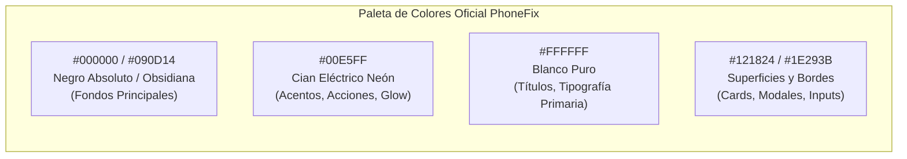

# 08. Diseño Frontend y Experiencia de Usuario (UI/UX)

Este documento establece el **Sistema de Diseño Oficial (Design System)** de PhoneFix basado en la identidad visual de la marca (fondo negro, cian eléctrico y blanco puro), diagnostica los problemas de maquetación y adaptabilidad de pantalla detectados en el código actual, y detalla el plan de reescritura de los componentes frontend para garantizar una interfaz responsiva, moderna y elegante.

---

## 1. Identidad Visual Oficial (Manual de Marca PhoneFix)

A partir del logotipo oficial de PhoneFix, la plataforma adopta una estética **Dark Tech Studio / Cyber-Clean**: sobria, de alto contraste, moderna y profesional.



### A. Especificación de Colores

| Rol del Color | Token Tailwind / Nombre | Código Hex | Uso en la Interfaz |
| :--- | :--- | :--- | :--- |
| **Fondo Principal** | `bg-dark-base` | `#080B11` | Fondo general de toda la aplicación (body y contenedor raíz). |
| **Superficie / Cards** | `bg-dark-surface` | `#111726` | Tarjetas de información, formularios, barra lateral y modales. |
| **Superficie Elevada** | `bg-dark-elevated` | `#182235` | Menús flotantes, dropdowns, estados hover y badges. |
| **Acento Primario** | `text-cyan-brand` / `bg-cyan-brand` | `#00E5FF` | Botones principales, estados activos, toggles, logo "FIX" y glow. |
| **Acento Secundario** | `cyan-hover` | `#00C2D8` | Hover de botones de acción y degradados secundarios. |
| **Tipografía Primaria** | `text-white` | `#FFFFFF` | Encabezados, títulos de sección y textos destacados. |
| **Tipografía Secundaria**| `text-slate-400` | `#94A3B8` | Subtítulos, descripciones secundarias y placeholders. |
| **Bordes Sutiles** | `border-dark-border` | `#1E293B` | Separadores de sección, contornos de inputs y tarjetas. |
| **Estado Éxito** | `text-emerald-400` | `#10B981` | Reparación terminada, pago completado, garantía vigente. |
| **Estado Peligro / Alerta**| `text-rose-500` | `#F43F5E` | Equipo sin garantía, plazo > 90 días vencido, stock crítico. |

---

### B. Isotipo y Logotipo Oficial
* **Isotipo Monograma:** Letras entrelazadas **`P` y `F`** donde la barra curva superior es **Blanco Puro** y el circuito interno es **Cian Eléctrico**.
* **Wordmark:** `P H  N E   F I X`
  * `PHONE`: Tipografía sans-serif geométrica en **Blanco**, con el isotipo de la manzana de Apple reemplazando a la letra **O**.
  * `FIX`: Tipografía en **Cian Eléctrico (`#00E5FF`)** con tracking amplio.

---

## 2. Diagnóstico de Problemas Actuales en la Maquetación

Durante la inspección del código existente en `phone-fix-frontend`, se detectaron errores estructurales que ocasionaban que el contenido no cubriera adecuadamente la pantalla o provocara desbordamientos visuales:

### 1. Fórmulas Rígidas de Altura (`Magic Numbers`)
* En `src/features/sales/pages/PosPage.tsx` se utilizaba:
  ```tsx
  <div className="flex h-[calc(100vh-100px)] gap-6">
  ```
  * **Problema:** En laptops de 13"-14" (resolución 1366x768) o con escalado de Windows al 125%, el offset fijo de `100px` rompe la proporción vertical, provocando dobles barras de scroll o cortando los botones de cobro del carrito.
  * **Solución:** Migrar a layouts flexibles basados en **Flexbox (`flex-1 min-h-0`)** y unidades modernas como **`h-dvh` (Dynamic Viewport Height)**, permitiendo que el área de scroll interna se adapte automáticamente al espacio restante sin números mágicos.

### 2. Doble Barra de Scroll y Scrollbar Incontrolado
* `MainLayout.tsx` configuraba `h-screen overflow-y-auto` en el `<main>` mientras que componentes hijos tenían su propio `overflow-y-auto`.
* **Solución:** Establecer un único contenedor de desplazamiento global o definir claramente qué panel tiene scroll interno (ej. en el POS: el catálogo tiene scroll independiente y el ticket de compra queda fijo/sticky al costado).

### 3. Colapso Inadecuado en Móviles y Tablets
* El sidebar en móviles se reducía a `w-20` (80px), ocupando más del 22% del ancho en teléfonos pequeños (360px-390px) y mostrando botones diminutos difíciles de presionar.
* **Solución:**
  * **En Desktop (`lg:` en adelante):** Sidebar lateral completo de 260px con opción a colapso minimalista.
  * **En Tablets y Móviles (`sm:` y `md:`):** Sidebar oculto por defecto accesible mediante un **Drawer lateral deslizante** con botón hamburguesa en el header, complementado con una barra de acceso rápido inferior (*Bottom Nav*) para acciones clave de mostrador.

### 4. Desalineación Cromática (El verde azulado desactualizado)
* El código actual utilizaba `teal-500` (`#14b8a6`) y fondos claros `bg-slate-50`. Esto no corresponde a la marca oficial de PhoneFix.
* **Solución:** Reconfigurar `tailwind.config.js` y `index.css` para aplicar la paleta oscura oficial con acentos cian eléctrico `#00E5FF`.

---

## 3. Plan de Reescritura y Rediseño de Vistas

A continuación se detalla cómo se ordenarán y adaptarán visualmente los componentes en cada pantalla:

### A. Layout Principal (`MainLayout.tsx`)
* **Estructura del Viewport:** Contenedor maestro con `min-h-dvh bg-[#080B11] text-slate-100 flex`.
* **Sidebar Dark Tech:**
  * Fondo `#0D131F` con borde derecho sutil `#1E293B`.
  * Cabecera con el **logotipo oficial vectorizado** (Isotipo P-F + texto PHONE FIX con brillo sutil).
  * Menú de navegación con estados activos resaltados en fondo cian traslúcido (`bg-cyan-500/10 border-l-2 border-[#00E5FF] text-[#00E5FF]`).
  * Perfil de usuario en la base mostrando rol (`ADMIN` o `STAFF`) con botón de cierre de sesión.
* **Header Superior Sticky:**
  * Fondo `#080B11/80 backdrop-blur-md` con borde inferior `#1E293B`.
  * Buscador universal de órdenes, tickets correlativos o clientes con atajo de teclado (`Ctrl + K`).
  * Indicador de sucursal activa y botón de menú móvil.

---

### B. Inicio de Sesión (`LoginPage.tsx`)
* **Alineación de Marca:**
  * Fondo negro profundo con sutiles esferas de luz cian difuminadas (`blur-[140px] opacity-25`).
  * Tarjeta central con efecto Glassmorphism oscuro: fondo `#0F172A/80`, borde `#1E293B`, esquinas redondeadas `rounded-3xl` y sombra profunda.
  * Presencia prominente del **Logotipo Oficial de PhoneFix** centrado en la parte superior.
  * Inputs con iconos vectoriales en gris claro que se iluminan en cian eléctrico al enfocar (`focus:ring-2 focus:ring-[#00E5FF] focus:border-[#00E5FF]`).
  * Botón de ingreso con gradiente `from-[#00E5FF] to-[#0099FF]` con texto en negro profundo para máximo contraste y legibilidad.

---

### C. Recepción de Equipos (`NewOrderPage.tsx`)
Organización visual en **Grid Responsivo Adaptable** (3 columnas en pantallas grandes $\ge$ 1280px; 2 columnas en medianas $\ge$ 1024px; 1 columna en tablets/móviles):

```text
┌────────────────────────────────────────────────────────────────────────┐
│ Encabezado: "Nueva Recepción de Equipo"       Badge: "Ticket #29"     │
├───────────────────────┬───────────────────────┬────────────────────────┤
│ COLUMNA 1: CLIENTE    │ COLUMNA 2: EQUIPO     │ COLUMNA 3: COTIZACIÓN │
│ • Nombre Completo     │ • Marca (Selector)    │ • Presupuesto (Bs.)    │
│ • Celular (WhatsApp)  │ • Modelo (Input)      │ • Pago a cuenta / Seña │
│ • Teléfono Referencia │ • Color               │ • Tipo: Efectivo / QR  │
│ • C.I. / NIT          │ • IMEI (Opcional)     │ • Saldo Pendiente      │
│                       │ • Patrón Táctil o PIN │ • Fecha de Entrega     │
├───────────────────────┴───────────────────────┴────────────────────────┤
│ DIAGNÓSTICO Y EVIDENCIA FÍSICA (Ancho Completo):                       │
│ • Falla reportada por el cliente (Textarea amplio)                     │
│ • Checklist de condición física: [Pantalla Rota] [Mojado] [No enciende]│
│ • Subida de Fotos a MinIO: Zona de arrastre (Dropzone) o cámara        │
├────────────────────────────────────────────────────────────────────────┤
│ ACCIÓN INFERIOR: Botón Grande "Registrar e Imprimir Ticket" (Cyan Glow)│
└────────────────────────────────────────────────────────────────────────┘
```

* **Detalles Clave:**
  * El componente `PatternLock` (patrón de 9 puntos) se ajusta a un contenedor responsivo que no desborda la columna del equipo.
  * La zona de evidencia física permite tomar fotos directamente desde la cámara del celular/tablet o adjuntar archivos hacia **MinIO**.

---

### D. Taller Activo y Gestión de Reparaciones (`WorkshopPage.tsx` y `WorkshopTableView.tsx`)
* **Layout de Tabla Ancha sin Saltos de Línea:**
  * Contenedor con `min-w-[1300px]` y desplazamiento horizontal suave.
  * Columna de Ticket con `whitespace-nowrap` y padding balanceado, garantizando que el número correlativo (`#TKT-XXX`) y la marca/modelo se visualicen en una sola línea pulcra.
  * Centrado visual y badges de estado cromáticos unificados sin desfasajes de grilla.
* **Flujo Operativo en 4 Fases Claras:**
  1. **Fase 1: En Diagnóstico / Revisión:**
     * Enfocado en inspección física, checklist de ingreso, notas reservadas para el personal y fotos en MinIO.
     * **Separación de responsabilidades:** Se ocultan intencionalmente las tarjetas de liquidación de saldo y facturación para no saturar al técnico en fases tempranas.
     * Muestra el presupuesto inicial acordado y botón de contacto WhatsApp para enviar cotización formal post-desarmado.
  2. **Fase 2: En Reparación / Mesa de Trabajo:**
     * Visualización detallada de repuestos y piezas solicitadas.
     * **Barra de Auditoría Presupuestaria (`Budget Cap`):** Indicador visual en tiempo real que alerta si la suma de repuestos cotizados supera el presupuesto general aprobado.
     * Selector de caseta externa con discriminación de canal de egreso (`💵 Efectivo / Caja Chica` vs `📱 QR / Banco Empresa`).
  3. **Fase 3: Listos para Retiro / Por Entregar:**
     * Activación de la tarjeta de liquidación final.
     * Selector de período de garantía con **`3 Semanas (Estándar)`** seleccionado por defecto (ajustable por Admin a 3 meses o sin garantía).
     * Registro de cobro del saldo pendiente discriminado en Efectivo y/o QR.
     * Generación e impresión instantánea de factura/recibo formal en PDF mediante **ReportLab + MinIO**.
  4. **Fase 4: Entregados & Historial:**
     * Registro inmutable de equipos devueltos al cliente, fecha y hora de entrega, garantía vigente y descarga de comprobantes históricos.
* **Modal de Detalle Técnico (`RepairDetailModal.tsx`):**
  * Diseñado con 4 pestañas modulares (`Diagnóstico`, `Reparación & Repuestos`, `Liquidación & Entrega`, `Historial & Auditoría`).
  * Área de **Observaciones Internas del Personal**: campo exclusivo para técnicos con icono de candado, protegiendo notas sensibles sobre daños preexistentes o contingencias en mesa de soldadura.

---

### E. Punto de Venta - POS (`PosPage.tsx`)
Solución definitiva a los problemas de altura y visualización:

```text
┌────────────────────────────────────────────────┬──────────────────────┐
│ CATÁLOGO DE PRODUCTOS (flex-1)                 │ CARRITO DE VENTA     │
│ • Buscador rápido superior                     │ (w-96, Sticky / Fijo)│
│ • Filtros: [Todos] [Accesorios] [Repuestos]    │ • Lista de ítems     │
│ • Botón Exclusivo ADMIN: "+ Venta Libre/Manual"│ • Selector cantidad  │
│                                                ├──────────────────────┤
│ Grid fluido de Tarjetas de Producto:           │ TOTAL A COBRAR (Bs.) │
│ ┌──────────────┐ ┌──────────────┐              │ • Monto Efectivo     │
│ │ Cable USB-C  │ │ Vidrio 9D    │              │ • Monto QR           │
│ │ Stock: 15    │ │ Stock: 50    │              ├──────────────────────┤
│ │ Bs. 35.00    │ │ Bs. 20.00    │              │ Botón: "Cobrar Venta"│
│ └──────────────┘ └──────────────┘              └──────────────────────┘
└───────────────────────────────────────────────────────────────────────┘
```

* **Venta Libre Manual (Exclusivo ADMIN):** Un botón especial `+ Venta Manual` abre un modal para ingresar nombre, precio cobrado y costo aproximado al aire, sin requerir que el producto exista en stock.
* **Layout sin `100vh - 100px`:** El catálogo usa `overflow-y-auto` en su propio contenedor mientras que el carrito se mantiene anclado al lateral derecho en desktop o en un modal deslizable (*Bottom Sheet*) en móvil.

---

### F. Arqueo y Cierre de Caja (`CashClosePage.tsx`)
* **Tarjetas KPI Superiores con Iluminación Neón:**
  1. **Base Inicial:** Fondo oscuro con icono en gris plata.
  2. **Total Ventas Efectivo (+):** Con acento esmeralda.
  3. **Total Cobros Taller (+):** Con acento cian.
  4. **Salidas Caja Chica (-):** Con acento rojo/rosa.
* **Sección de Conciliación Bicanal:**
  * **Columna 1 (Caja Física):** Cálculo de efectivo esperado en mano vs campo numérico donde el encargado tipea el dinero físico contado $\rightarrow$ Muestra la diferencia (+ sobrante, - faltante) en color dinámico.
  * **Columna 2 (Caja Virtual / Bancos):** Sumatoria total de operaciones por QR del día para verificar con el extracto bancario.
  * Botón para adjuntar captura del cierre o extracto hacia **MinIO**.

---

### G. Directorio y Formulario de Proveedores (`SuppliersPage.tsx` y `SupplierModal.tsx`)
* Directorio dedicado con tarjetas Dark Tech para gestionar casetas de Montero y Santa Cruz:
  * **Nombre de la Tienda / Proveedor** (Obligatorio).
  * **Lugar / Mercado** (Comercial Chiriguano, La Ramada, Montero Central).
  * **Nº de Caseta / Pasillo**.
  * **Nombre del Técnico / Contacto**.
  * **Celular de Referencia** con botón directo a WhatsApp.
  * **Especialidad o Notas**.

---

### H. Libro Contable General Bicanal (`AccountingLedgerPage.tsx`)
* **5 Tarjetas KPI con Iluminación Neón:**
  1. *Total Ingresos (+):* Fondo Esmeralda Neón.
  2. *Total Egresos (-):* Fondo Rosa Neón.
  3. *Balance Neto:* Fondo Cian Neón con cálculo dinámico.
  4. *Caja Efectivo Disponible:* Gaveta física real en bolivianos.
  5. *Banco / QR Disponible:* Saldo digital en cuentas bancarias.
* **Tabla Bicanal de 11 Columnas:** Detalle cronológico inmutable con origen de operación, ticket de taller correlativo, entrada efectivo, entrada QR, salida efectivo, salida QR y saldo neto acumulado.
* **Filtros Temporales y Exportación:** Selector de rango de fechas y botón de descarga directa a Excel (.csv con soporte UTF-8 BOM).

---

### I. Gestión de Clientes y Fidelización (`ClientsPage.tsx` y `NewOrderPage.tsx`)
* **Detección Instantánea por C.I. en Recepción:** Al tipear el documento del cliente en la nueva orden, un banner inteligente notifica si el cliente ya existe y permite precargar sus datos con un solo clic.
* **Contador de Visitas y Badges:** Cada cliente en el directorio muestra un contador de reparaciones (`🔄 X órdenes`) y una insignia dorada de fidelización (`⭐ Cliente Recurrente`) cuando registra 2 o más visitas al taller.

---

## 4. Hoja de Estilos Tailwind y Tokens del Sistema

Para materializar esta identidad en el código, se reemplaza la configuración de colores de `tailwind.config.js` y `index.css`:

```javascript
// Configuración propuesta en tailwind.config.js
module.exports = {
  darkMode: 'class',
  theme: {
    extend: {
      colors: {
        dark: {
          base: '#080B11',     // Fondo principal
          surface: '#111726',  // Tarjetas y paneles
          elevated: '#182235', // Menús, dropdowns, hover
          border: '#1E293B',   // Líneas divisorias
        },
        brand: {
          cyan: '#00E5FF',     // Cian oficial PhoneFix
          'cyan-hover': '#00C2D8',
          'cyan-glow': 'rgba(0, 229, 255, 0.15)',
        }
      },
      fontFamily: {
        sans: ['Outfit', 'Inter', 'system-ui', 'sans-serif'],
      }
    }
  }
}
```

---

## 5. Resumen de Ventajas del Nuevo Enfoque Frontend

1. **Alineación 100% de Marca:** PhoneFix lucirá como una herramienta tecnológica premium, oscura y profesional, acorde con su logotipo oficial.
2. **Eliminación Total de Problemas de Altura:** Sin fórmulas estáticas como `calc(100vh - 100px)`; la aplicación llenará el 100% del viewport dinámico (`100dvh`) con scroll controlado e independiente.
3. **Responsividad Real en Talleres:** Podrá usarse indistintamente en la computadora del mostrador, en una tablet en la mesa de soldadura o en el celular del técnico cuando va a cotizar repuestos a una caseta del mercado.
4. **Protección Visual por Permisos:** Los botones de alta sensibilidad (Venta Libre Manual, Declaración de Abandono > 90 días, costos de caja chica) se ocultarán para técnicos comunes mediante el componente `<Can permission="...">`.
