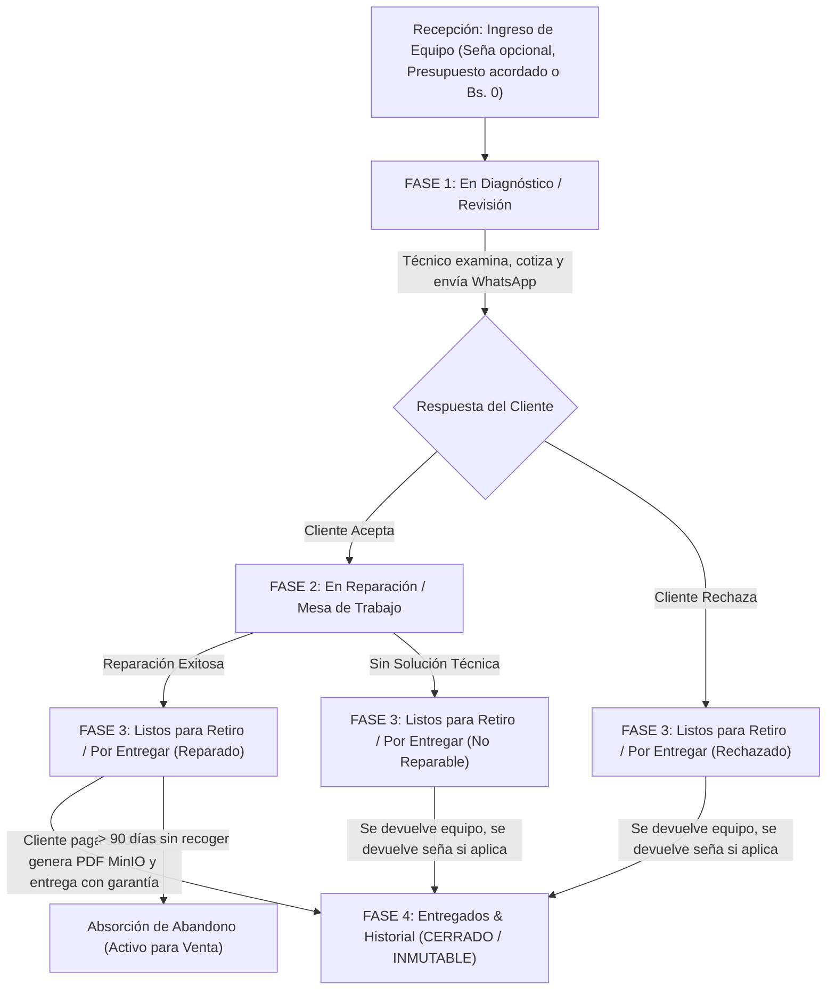

# 10. Especificación y Flujo Integral del Taller, Control Presupuestario y Libro Contable

Este documento define la arquitectura oficial, reglas de negocio, ciclo de vida del dispositivo y modelo financiero para el módulo de taller de **PhoneFix Montero**. Resuelve las inconsistencias detectadas en la doble cotización, delimita los campos de diagnóstico/autorización, estructura las 3 fases operativas del taller y garantiza la inmutabilidad contable.

---

## 1. Ciclo de Vida del Dispositivo y las 3 Fases Operativas del Taller

El flujo de trabajo se divide en **3 fases operativas activas** más una **fase histórica de archivo**:



### Tabla de Fases y Estados Permitidos

| Fase en la Interfaz | Estados de la Orden Incluidos | Objetivo Operativo | Acciones y Tarjetas Visibles |
| :--- | :--- | :--- | :--- |
| **1. En Diagnóstico / Revisión** | `RECIBIDO`<br>`DIAGNOSTICO`<br>`ESPERA_CLIENTE` | Abrir el equipo, diagnosticar fallas reales, cotizar costo total y fijar fecha de entrega. | • Falla inicial y checklist recepción.<br>• Clave / Patrón de desbloqueo.<br>• Diagnóstico técnico editable.<br>• Presupuesto acordado y fecha de entrega.<br>• Envío a WhatsApp y botones Aceptar/Rechazar.<br>❌ **Liquidación y Factura OCULTA**. |
| **2. En Reparación / Mesa de Trabajo** | `EN_PROCESO` | Técnico trabajando activamente en el banco de trabajo, solicitando repuestos a casetas o usando inventario. | • Diagnóstico técnico en **SOLO LECTURA** (consulta).<br>• Desglose de piezas y gastos con **Control de Techo Presupuestario**.<br>• Notas internas del personal.<br>• Botón `[ ✅ Marcar Reparado ]` o `[ ⚠️ Sin Solución ]`.<br>❌ **Liquidación y Factura OCULTA**. |
| **3. Listos para Retiro / Por Entregar** *(Nueva Pestaña)* | `REPARADO_ESPERA`<br>`NO_REPARABLE_ESPERA`<br>`RECHAZADO_ESPERA` | Equipos terminados esperando en mostrador a que el cliente venga a recogerlos y liquidar saldos. | • **Cobro de Saldo Pendiente** (Efectivo y/o QR).<br>• **Emisión de Comprobante / Factura PDF (MinIO)**.<br>• Selección de garantía (3 semanas estándar).<br>• Botón `[ Entregar y Finalizar ]` o `[ Devolver Seña ]`. |
| **4. Entregados & Historial** | `ENTREGADO_REPARADO`<br>`ENTREGADO_SIN_REPARAR`<br>`DECLARADO_ABANDONO` | Archivo histórico y respaldo fiscal/garantía. | • **100% MODO SOLO LECTURA (INMUTABLE)**.<br>• Consulta de vigencia de garantía.<br>• Reimpresión de factura / comprobante PDF. |

---

## 2. Regla de Negocio: Presupuesto Acordado vs. Piezas Auditadas (Resolución de "Doble Cotización")

### El Problema Detectado
Anteriormente se solicitaba un "Presupuesto Cotizado Real" general y, al agregar piezas en el desglose, se pedía nuevamente un "Precio Cobrado al Cliente" por cada ítem sin relación ni validación con el presupuesto general. Esto generaba duplicidad, confusión y descuadre contable.

### La Solución PhoneFix: Techo Presupuestario y Auditoría de Gastos

1. **Presupuesto Acordado con el Cliente (`estimated_total`):**
   * Es el **monto total cerrado** que el cliente se compromete a pagar (ej: **Bs. 300**).
   * Puede definirse en recepción (si la falla es evidente, ej: cambio de pantalla estándar) o tras el diagnóstico en laboratorio (si ingresó con Bs. 0).

2. **Auditoría de Piezas y Salidas de Caja Chica (`RepairPartItem`):**
   * Cada pieza o servicio agregado registra:
     * **Descripción** (ej: *Pantalla OLED A14*, *Pin tipo C*, *Mano de obra*).
     * **Origen** (Almacén interno o Proveedor/Caseta externa).
     * **Costo Real de Proveedor / Caja Chica (`cost`)**: Lo que le cuesta el repuesto a PhoneFix (ej: **Bs. 180**).
     * **Precio al Cliente (`price`)**: El valor que compone la factura del cliente (ej: **Bs. 250** repuesto + **Bs. 50** servicio = **Bs. 300**).

3. **Control del Techo Presupuestario (Budget Cap):**
   * La interfaz calcula en tiempo real:
     $$\text{Suma de Piezas Cargadas} \le \text{Presupuesto Acordado}$$
     $$\text{Ganancia Estimada} = \text{Presupuesto Acordado} - \sum \text{Costos de Caja Chica}$$
   * **Alerta Visual de Exceso:** Si el técnico intenta agregar repuestos cuyo precio o costo sobrepase el presupuesto acordado, el sistema muestra:
     > ⚠️ **Presupuesto Excedido:** El total de ítems (Bs. 350) excede el presupuesto aprobado por el cliente (Bs. 300). Requiere contactar al cliente para renegociar o ajustar el monto cotizado.

---

## 3. Delimitación Estricta de Campos de Texto

Para evitar que un campo sobreescriba a otro o cause confusión en el modal de detalle, se establecen 4 campos independientes:

| Nombre del Campo | Campo en BD | Dónde se Llena | Propósito y Audiencia |
| :--- | :--- | :--- | :--- |
| **Falla Reportada por Cliente** | `issue_description` | En Recepción | Lo que el cliente afirma que le pasa a su teléfono ("Se cayó al agua", "No carga"). Inmutable como registro testimonial. |
| **Diagnóstico Técnico de Laboratorio** | `technician_notes` | En Taller (Fase Diagnóstico) | Lo que el técnico encontró al desmontar el equipo en microscopio/multímetro ("Línea VDD en corto, flex sulfatado, pantalla no emite imagen"). |
| **Trabajo Autorizado por Cliente** | `authorized_work` | En Taller (Al cotizar) | El alcance exacto acordado con el cliente ("Autorizó solo cambio de pin y limpieza ultrasónica; pantalla rota queda pendiente"). |
| **Observaciones Internas del Personal** | `tech_observations` | En cualquier momento | Notas privadas para el equipo ("Cliente conflictivo", "Viene con tornillo barrido de otro taller"). **NO sale en la factura.** |

---

## 4. Máquina de Estados Contextual (State Machine)

Se prohíbe el selector libre desordenado de 10 estados. En su lugar, el estado se gestiona mediante **botones de acción contextuales** según la fase:

```
[RECIBIDO] 
   └──> [DIAGNOSTICO] (Al comenzar a revisar)
           └──> [ESPERA_CLIENTE] (Al cotizar y enviar WhatsApp)
                   ├──> [EN_PROCESO] (Cliente aceptó ➔ Pasa a Mesa de Trabajo)
                   └──> [RECHAZADO_ESPERA] (Cliente rechazó ➔ Pasa a Listos para Retiro)

[EN_PROCESO] (En Mesa de Trabajo)
   ├──> [REPARADO_ESPERA] (Reparación concluida con éxito ➔ Pasa a Listos para Retiro)
   └──> [NO_REPARABLE_ESPERA] (Sin solución tras laboratorio ➔ Pasa a Listos para Retiro)

[REPARADO_ESPERA / RECHAZADO_ESPERA / NO_REPARABLE_ESPERA] (En Listos para Retiro)
   ├──> [ENTREGADO_REPARADO] (Cobro de saldo, factura PDF, garantía ➔ Cierra orden)
   ├──> [ENTREGADO_SIN_REPARAR] (Devolución de equipo y seña si aplica ➔ Cierra orden)
   └──> [DECLARADO_ABANDONO] (Exclusivo Admin si días >= 90 ➔ Absorbe activo)
```

---

## 5. Módulo de Libro Contable Inmutable y Conciliación Bicanal
*(Estado: **COMPLETADO**)*

* **Ruta:** `/contabilidad`
* **Acceso:** Exclusivo Administrador y usuarios con permiso contable (`caja.movimientos.ver`).
* **Naturaleza:** 100% Inmutable (Solo lectura forense).
* **Consolidación Integral:**
  * Ventas Mostrador (Efectivo y QR).
  * Señas de Taller (Efectivo y QR).
  * Saldos de Entrega de Taller (Efectivo y QR).
  * Egresos de Caja Chica (Compras de repuestos pagadas en efectivo).
  * Egresos Bancarios / QR (Compras de repuestos pagadas por transferencia bancaria / QR).
  * Devoluciones de Señas (clasificadas en efectivo o por QR según el canal utilizado).
* **Tarjetas KPI Bicanal:**
  * **Ingresos Brutos Totales:** Suma de todas las entradas en efectivo y QR.
  * **Saldo Físico Gaveta:** Conciliación estricta de billetes en caja ($\sum \text{Efectivo In} - \sum \text{Egreso Efectivo}$).
  * **Saldo Banco / QR:** Conciliación de cuenta bancaria ($\sum \text{QR In} - \sum \text{Egreso QR}$).
  * **Egresos Totales:** Desglose visible de gastos en efectivo vs. transferencias QR.
  * **Rendimiento Neto:** Ganancia operativa líquida real ($\text{Ingresos} - \text{Egresos}$).
* **Exportación CSV:** Compatible nativamente con Microsoft Excel para Windows (UTF-8 con BOM y delimitador `;`).
* **Manual de Usuario:** Documentado íntegramente en [11_GUIA_USUARIO_LIBRO_CONTABLE.md](./11_GUIA_USUARIO_LIBRO_CONTABLE.md).

---

## 6. Detección de Clientes Recurrentes por C.I. y Contador de Visitas
*(Estado: **COMPLETADO**)*

Para evitar la duplicidad de clientes y premiar la fidelización:

1. **Unicidad en Base de Datos & GraphQL ([`clients/graphql.py`](file:///d:/proyectoPF/phone-fix-backend/clients/graphql.py)):**
   * En la mutación `create_client`, antes de insertar un nuevo registro, se comprueba si el `ci` ya existe (o el celular principal `phone_primary`).
   * Si existe, se actualizan datos faltantes y se asocia la nueva orden de reparación a su `id` existente.
   * Se exponen en `ClientType`:
     * `repairs_count: int`: Total histórico de órdenes asociadas al cliente.
     * `is_recurrent: bool`: `True` cuando `repairs_count >= 2`.

2. **Detección Reactiva en Recepción ([`NewOrderPage.tsx`](file:///d:/proyectoPF/phone-fix-frontend/src/features/reception/pages/NewOrderPage.tsx)):**
   * Al ingresar el C.I. o teléfono del cliente en el formulario de recepción, el sistema detecta de inmediato al cliente existente y despliega un banner informativo:
     > ⚡ **Cliente Detectado:** [Nombre] • [X] órdenes previas en PhoneFix • [ ⭐ Cliente Recurrente ] `[ Cargar Datos ]`
   * Al hacer clic en `[ Cargar Datos ]`, se completan automáticamente el nombre, teléfono y referencia familiar.

3. **Tarjeta de Cliente con Contador ([`ClientsPage.tsx`](file:///d:/proyectoPF/phone-fix-frontend/src/features/clients/pages/ClientsPage.tsx)):**
   * Cada tarjeta en el directorio de clientes incluye:
     * Contador correlativo: `🔄 X órdenes`.
     * Insignia dorada de fidelización: `⭐ Recurrente / Frecuente` cuando registra 2 o más visitas.

---

## 7. Discriminación Bicanal de Egresos en Taller (Efectivo vs. QR)
*(Estado: **COMPLETADO**)*

1. **Modelos de Datos ([`workshop/models.py`](file:///d:/proyectoPF/phone-fix-backend/workshop/models.py)):**
   * En `RepairPartItem`: Campo `payment_method` con opciones `EFECTIVO` (Caja Chica) y `QR` (Transferencia bancaria / QR).
   * En `RepairOrder`: Campo `deposit_refund_method` con opciones `EFECTIVO` y `QR`.
   * Migración `0004` aplicada exitosamente en PostgreSQL.

2. **Imputación de Piezas en Taller ([`AddLineItemModal.tsx`](file:///d:/proyectoPF/phone-fix-frontend/src/features/workshop/components/AddLineItemModal.tsx)):**
   * Al registrar un repuesto externo de caseta, el técnico o cajero selecciona el canal de egreso:
     * `[ 💵 Efectivo (Caja Chica) ]`
     * `[ 📱 QR / Banco Empresa ]`

3. **Devolución de Seña ([`RepairDetailModal.tsx`](file:///d:/proyectoPF/phone-fix-frontend/src/features/workshop/components/RepairDetailModal.tsx)):**
   * Al devolver un anticipo por un equipo no reparable o rechazado, se define si el reintegro se realiza en billetes físicos o por transferencia QR.

4. **Reflejo en Libro Contable ([`AccountingLedgerPage.tsx`](file:///d:/proyectoPF/phone-fix-frontend/src/features/sales/pages/AccountingLedgerPage.tsx)):**
   * Columnas separadas en la tabla: `Efec. In (+)`, `QR In (+)`, `Egreso Ef. (-)`, `Egreso QR (-)`, `Neto (Bs.)`.
   * Garantiza que la gaveta física de billetes nunca se descuadre cuando un repuesto se compra con dinero digital de la cuenta bancaria.
