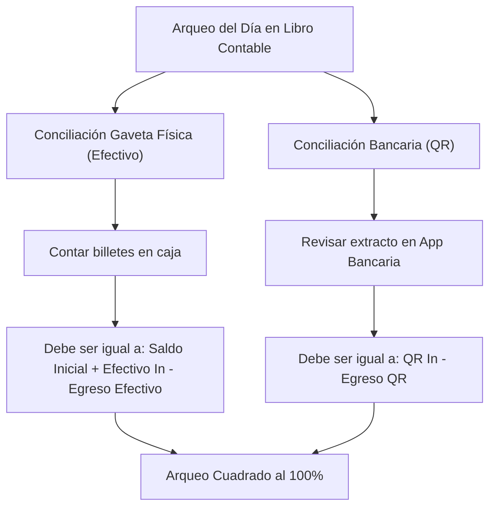

# 11. Guía Visual y Manual del Usuario: Libro Contable General (PhoneFix Montero)

Este manual describe en detalle cada uno de los elementos gráficos, componentes visuales, tarjetas de métricas (KPIs), filtros y columnas que componen la pantalla de **Libro Contable General (`/contabilidad`)** en PhoneFix. 

Su propósito es servir como material de referencia para el **administrador, dueño, cajero y personal de auditoría**, explicando qué significa cada elemento, de dónde provienen los números y cómo interpretar la conciliación entre el dinero en efectivo (gaveta física) y el dinero digital (Banco / QR).

---

## 1. Encabezado y Barra Superior

Ubicada en la parte superior de la pantalla, provee el contexto de seguridad y las herramientas de exportación y actualización.

```
+---------------------------------------------------------------------------------------------------+
|  [📖 Libro Contable General] [🔒 Inmutable (Solo Admin)]   [📥 Exportar CSV para Excel] [🔄 Recargar] |
|  Auditoría consolidada de ingresos y egresos (Mostrador POS, señas, liquidaciones y compras)       |
+---------------------------------------------------------------------------------------------------+
```

### Componentes:
1. **Título con Icono de Libro (`BookOpen`)**:
   - Identifica el módulo contable oficial de PhoneFix.
2. **Insignia de Inmutabilidad (`🔒 Inmutable (Solo Admin)`)**:
   - **Qué significa:** Indica que los asientos contables generados en esta pantalla son de **solo lectura**. Nadie (ni técnicos ni recepcionistas) puede alterar, editar o borrar un movimiento contable una vez que fue registrado. Garantiza transparencia total ante auditorías.
3. **Botón `[ 📥 Exportar CSV para Excel ]`**:
   - **Qué hace:** Descarga instantáneamente un archivo `.csv` estructurado con codificación `UTF-8 con BOM` (Byte Order Mark) y delimitador punto y coma (`;`).
   - **Beneficio para el usuario:** Permite abrir el reporte en Microsoft Excel en Windows con un solo clic sin que se deformen los acentos, caracteres especiales ni los decimales en Bolivianos (Bs.).
   - **Contenido del archivo exportado:** Encabezado con fecha de generación, resumen financiero y la totalidad de los asientos filtrados con sus 11 columnas.
4. **Botón `[ 🔄 Refrescar ]`**:
   - Reejecuta la consulta GraphQL en tiempo real para traer ventas o reparaciones recién registradas sin recargar toda la página del navegador.

---

## 2. Barra de Filtros, Presets y Búsqueda

Permite acotar la auditoría a un período específico o localizar una orden particular.

```
+---------------------------------------------------------------------------------------------------+
| 📅 Desde: [ 2026-09-11 ]  Hasta: [ 2026-10-11 ]  [Hoy] [Este Mes] [30 Días]                       |
| 🔍 [ Buscar concepto o ticket... ]   [ Tipo: Todos los Movimientos ▾ ]                           |
+---------------------------------------------------------------------------------------------------+
```

### Elementos Interactivos:
1. **Selector de Rango de Fechas (`Desde:` y `Hasta:`)**:
   - Entradas de fecha de tipo calendario. Por defecto cargan los últimos 30 días para brindar un panorama inmediato de la salud financiera del taller.
2. **Botones de Presets Rápidos:**
   - **`[ Hoy ]`:** Ajusta automáticamente el inicio y fin al día actual. Ideal para el arqueo de caja al final de la jornada.
   - **`[ Este Mes ]`:** Configura el rango desde el primer día del mes corriente hasta hoy (ej. del 1 de octubre al día de hoy). Permite ver el rendimiento acumulado mensual.
   - **`[ 30 Días ]`:** Restaura el rango móvil de los últimos 30 días.
3. **Caja de Búsqueda en Vivo (`Search`)**:
   - Permite escribir en tiempo real para filtrar filas por:
     - Número de ticket (ej. `PF-2610-0001`).
     - Nombre del cliente (ej. `Ronald Justiniano`).
     - Proveedor o Caseta externa (ej. `Caseta #12 Comercial Chiriguano`).
     - Concepto o repuesto (ej. `Pantalla OLED Samsung A14`).
4. **Selector Desplegable de Tipo de Operación (`Dropdown Filter`)**:
   - Permite aislar un tipo específico de movimiento:
     * **Todos los Movimientos:** Muestra el flujo completo consolidado.
     * **Ventas de Mostrador:** Solo ventas POS de accesorios y cargadores.
     * **Señas de Taller:** Solo pagos de anticipo recibidos al recepcionar equipos.
     * **Liquidaciones de Taller:** Solo saldos cobrados al momento de entregar un equipo reparado.
     * **Compras a Casetas:** Solo compras externas de repuestos imputados a reparaciones.
     * **Devoluciones de Señas:** Solo reintegros efectuados a clientes por equipos sin solución o presupuestos rechazados.

---

## 3. Panel de Tarjetas Financieras (KPI Cards)

El panel superior de tarjetas resume la salud económica del período seleccionado y **discrimina exactamente dónde está el dinero físico y dónde el bancario**.

```
+------------------+------------------+------------------+------------------+------------------+
| Ingresos Totales | Efectivo Gaveta  | Banco / QR       | Egresos Totales  | Rendimiento Neto |
|  Bs. 12,450.00   |  Bs. 7,200.00    |  Bs. 5,250.00    |  Bs. 3,800.00    |  Bs. 8,650.00    |
| (Efectivo + QR)  | Saldo físico caja| Cuenta bancaria  | Efec: 2,100 | QR: 1,700 | 48 Asientos  |
+------------------+------------------+------------------+------------------+------------------+
```

### Detalle de cada Tarjeta:

### 1. Tarjeta: Ingresos Totales
* **Borde y Acento:** Cian (`#00E5FF`).
* **Icono:** `DollarSign` ($).
* **Fórmula:** $\text{Total Ingresos} = \text{Ingresos Efectivo} + \text{Ingresos QR}$.
* **Significado para el usuario:** Es el volumen bruto de dinero que ingresó a PhoneFix en el período, sumando mostrador y taller, sin descontar aún los gastos de repuestos.

### 2. Tarjeta: Efectivo Ingresado (Gaveta de Caja)
* **Borde y Acento:** Verde Esmeralda (`#10B981`).
* **Icono:** `ArrowDownLeft` (Flecha entrante).
* **Fórmula:** Suma de todas las ventas en efectivo + señas en efectivo + saldos finales en efectivo.
* **Significado para el usuario:** Billetes y monedas físicos que entraron materialmente al cajón de dinero.

### 3. Tarjeta: QR / Bancos
* **Borde y Acento:** Azul (`#3B82F6`).
* **Icono:** `QrCode`.
* **Fórmula:** Suma de pagos recibidos vía QR por ventas + señas por QR + saldos de taller por QR.
* **Significado para el usuario:** Dinero acreditado en las cuentas bancarias de PhoneFix (Banco Unión, BCP, BNB, etc.). Este dinero no está físicamente en la gaveta, está en la cuenta de la empresa.

### 4. Tarjeta: Salidas de Dinero / Egresos
* **Borde y Acento:** Rosa / Rojo Carmesí (`#F43F5E`).
* **Icono:** `ArrowUpRight` (Flecha saliente).
* **Sub-desglose:**
  - **Egreso en Efectivo:** Compras de repuestos en físico a casetas con dinero de la gaveta + devoluciones de seña en efectivo.
  - **Egreso por QR:** Repuestos pagados por transferencia bancaria QR + devoluciones por QR.
* **Significado para el usuario:** Alerta de todo el capital que salió del negocio para adquirir piezas o reintegrar señas.

### 5. Tarjeta: Rendimiento Neto (Utilidad Operativa)
* **Borde y Acento:** Gradiente Cian - Esmeralda (`#00E5FF` a `#10B981`).
* **Icono:** `TrendingUp` (Gráfica ascendente).
* **Fórmula:** $\text{Rendimiento Neto} = \text{Ingresos Totales} - \text{Egresos Totales}$.
* **Significado para el usuario:** Es la **ganancia líquida real** generada por el negocio en el rango consultado, una vez cubiertos los costos de todos los repuestos y devoluciones.

---

## 4. Tabla de Asientos Contables (Auditoría Registro por Registro)

La tabla central despliega cronológicamente cada transacción financiera con detalle forense.

```
+-----------------------------------------------------------------------------------------------------------------------+
| Fecha/Hora | Operación   | Concepto                | Ref.        | Efec.(+) | QR(+)   | Eg.Ef.(-) | Eg.QR.(-) | Neto    |
+------------+-------------+-------------------------+-------------+----------+---------+-----------+-----------+---------+
| 11/10 10:30| Venta POS   | Funda + Vidrio Templado | VTA-12      | 60.00    | -       | -         | -         | +60.00  |
| 11/10 11:15| Compra Cas. | Pantalla OLED A14       | PF-2410-001 | -        | -       | 180.00    | -         | -180.00 |
| 11/10 12:00| Compra Cas. | Batería Original Moto G | PF-2410-002 | -        | -       | -         | 95.00     | -95.00  |
| 11/10 14:20| Liq. Taller | Entrega Reparado A14    | PF-2410-001 | -        | 120.00  | -         | -         | +120.00 |
+-----------------------------------------------------------------------------------------------------------------------+
```

### Significado de cada Columna:

| Nº | Columna | Formato Visual | ¿Qué indica al usuario? |
| :---: | :--- | :--- | :--- |
| **1** | **Fecha / Hora** | `DD/MM/AAAA HH:MM` (Monoespaciado) | Momento exacto en que se registró la transacción en el sistema. |
| **2** | **Operación** | Badge de color con icono | Categoría funcional de la operación (ver catálogo de insignias abajo). |
| **3** | **Concepto** | Texto descriptivo (Blanco) | Resumen del movimiento (Dispositivo, cliente, repuesto adquirido o items vendidos). |
| **4** | **Referencia** | Código en cian negrita (Monoespaciado) | Número de Ticket de Taller correlativo (`PF-YYMM-XXXX`) o código de venta POS (`VTA-XX`). |
| **5** | **Efectivo In (Bs.)** | Número verde con signo `+` | Monto en bolivianos que ingresó en billete a la gaveta. Si es 0, muestra un guion tenue (`-`). |
| **6** | **QR In (Bs.)** | Número azul con signo `+` | Monto en bolivianos acreditado por transferencia QR bancaria. |
| **7** | **Egreso Efectivo (Bs.)** | Número rosa con signo `-` | Monto en bolivianos que **salió de la caja física** para pagar repuestos o devolver señas. |
| **8** | **Egreso QR (Bs.)** | Número violeta con signo `-` | Monto en bolivianos **transferido por banca móvil/QR** para pagar a proveedores o devolver señas. |
| **9** | **Neto (Bs.)** | Número en negrita resaltado | Impacto neto de este movimiento en las finanzas ($+$ positivo en blanco/verde, $-$ negativo en rojo). |
| **10** | **Responsable** | Texto atenuado | Usuario que realizó la venta, técnico encargado o nombre de la caseta proveedora. |
| **11** | **Notas Auditoría** | Texto secundario | Falla del equipo, notas de diagnóstico o comprobantes asociados. |

---

## 5. Catálogo de Insignias de Operación (Badges)

Cada asiento está codificado por color e icono para facilitar la lectura visual rápida:

* 🏷️ **`Venta POS` (Azul `#3B82F6` / Icono `DollarSign`):**
  - Venta de mostrador directa (cables, cargadores, fundas, audífonos, venta libre).
* 🏷️ **`Seña Taller` (Ámbar `#F59E0B` / Icono `ArrowDownLeft`):**
  - Anticipo monetario cobrado al cliente al momento de recibir su teléfono en recepción.
* 🏷️ **`Liquidación Taller` (Verde Esmeralda `#10B981` / Icono `ArrowDownLeft`):**
  - Cobro del saldo pendiente cuando el cliente recoge su teléfono reparado satisfactoriamente.
* 🏷️ **`Compra Caseta` (Rosa Carmesí `#F43F5E` / Icono `ArrowUpRight`):**
  - Egreso por compra externa de repuesto a caseta de La Ramada o Comercial Chiriguano. Puede haberse pagado en efectivo de caja chica o por QR de la empresa.
* 🏷️ **`Devolución Seña` (Púrpura `#A855F7` / Icono `ArrowUpRight`):**
  - Egreso por reintegro de dinero al cliente cuando el equipo no tuvo solución o el presupuesto fue rechazado tras diagnóstico.

---

## 6. Procedimiento de Arqueo y Conciliación para el Administrador

Al finalizar el día o la semana, el administrador de PhoneFix debe verificar que los números coincidan con la realidad física:



### Reglas de Oro:
1. **Si un técnico compró un repuesto con dinero de la gaveta:**
   - Debe registrarse como `Egreso Efectivo`. De lo contrario, faltará dinero físico al contar los billetes.
2. **Si el dueño transfirió por QR a la caseta:**
   - Debe registrarse como `Egreso QR`. Esto descuenta el saldo del banco pero **no afecta los billetes de la gaveta**.
3. **Inmutabilidad:**
   - Si se comete un error en un cobro o cotización, no se alteran asientos pasados: se registra la operación de ajuste correspondiente (devolución o nota de crédito) para preservar la trazabilidad fiscal.
