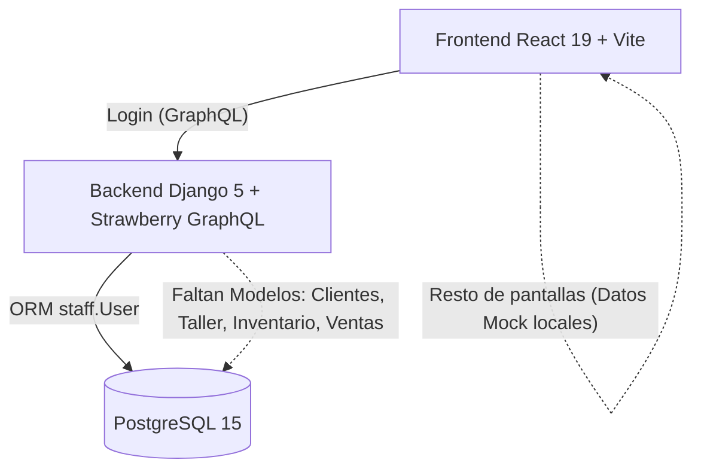

# PhoneFix - Documentación Oficial del Proyecto

Bienvenido a la documentación técnica y funcional de **PhoneFix** (proyecto `proyectoPF`). Este repositorio contiene un sistema web integral diseñado para la gestión operativa y comercial de talleres de servicio técnico de telefonía móvil y tiendas de repuestos/accesorios.

El proyecto estuvo en pausa durante aproximadamente 6 meses (último commit registrado en abril de 2026). Esta documentación recopila el estado exacto del código, la arquitectura, el modelo de negocio, las decisiones técnicas y la hoja de ruta para su reactivación.

---

## 📚 Índice de Documentación

| Documento | Descripción |
| :--- | :--- |
| [**01. Modelo de Negocio y Dominio**](./01_MODELO_DE_NEGOCIO.md) | Visión del producto, actores, roles (`ADMIN` vs `STAFF`), flujos de trabajo (Recepción, Taller, POS, Cierre de Caja, etc.) y particularidades operativas. |
| [**02. Arquitectura y Tecnologías**](./02_ARQUITECTURA_Y_TECNOLOGIAS.md) | Diagrama general de arquitectura, stack tecnológico (Django 5, Strawberry GraphQL, React 19, Tailwind v4, Apollo Client, PostgreSQL 15, Docker). |
| [**03. Estructura del Repositorio**](./03_ESTRUCTURA_DEL_PROYECTO.md) | Desglose exhaustivo del árbol de carpetas de Backend y Frontend, módulos Django y componentes de React. |
| [**04. Situación Actual y Diagnóstico**](./04_SITUACION_ACTUAL_Y_DIAGNOSTICO.md) | Radiografía técnica del código actual: qué funciona, qué está simulado (Mocks), el desfase entre Backend y Frontend, y deudas técnicas detectadas. |
| [**05. Roadmap y Plan de Reactivación**](./05_ROADMAP_Y_PLAN_DE_REACTIVACION.md) | Plan de acción paso a paso para completar el backend, conectar la API GraphQL con el frontend y llevar el sistema a producción. |
| [**06. Guía de Ejecución y Despliegue**](./06_GUIA_DE_EJECUCION_Y_DESPLIEGUE.md) | Instrucciones para levantar el proyecto con Docker Compose en local o manualmente, variables de entorno y notas sobre el VPS. |
| [**07. Estructura de Permisos (RBAC)**](./07_ESTRUCTURA_PERMISOS_RBAC.md) | Extracción del modelo dinámico de roles y permisos de COSMOL-Reportes y propuesta de implementación en PhoneFix (Django + Strawberry + React 19). |
| [**08. Diseño Frontend y UI/UX**](./08_DISENO_FRONTEND_Y_UI_UX.md) | Sistema de diseño oficial (Negro/Cian/Blanco), corrección de pantalla completa y responsividad, y rediseño de vistas. |

---

## ⚡ Resumen Ejecutivo del Estado del Repositorio

* **Frontend:** Tiene un diseño UI/UX muy avanzado y moderno (diseño minimalista, componentes de bloqueo por patrón, modales de gestión técnica, soporte para WhatsApp y arqueo de caja). La mayor parte funciona actualmente con **datos simulados (Mocks)** en memoria local.
* **Backend:** Posee la estructura base en Django 5 con soporte para Docker, PostgreSQL y autenticación JWT mediante GraphQL Strawberry (`login` operativo). Las aplicaciones (`clients`, `inventory`, `reception`, `sales`, `workshop`) están creadas pero **aún no tienen modelos de base de datos ni esquemas GraphQL implementados**.
* **Infraestructura:** Listo para ejecutarse mediante `docker-compose.yml` que orquesta PostgreSQL, Django y Vite.
