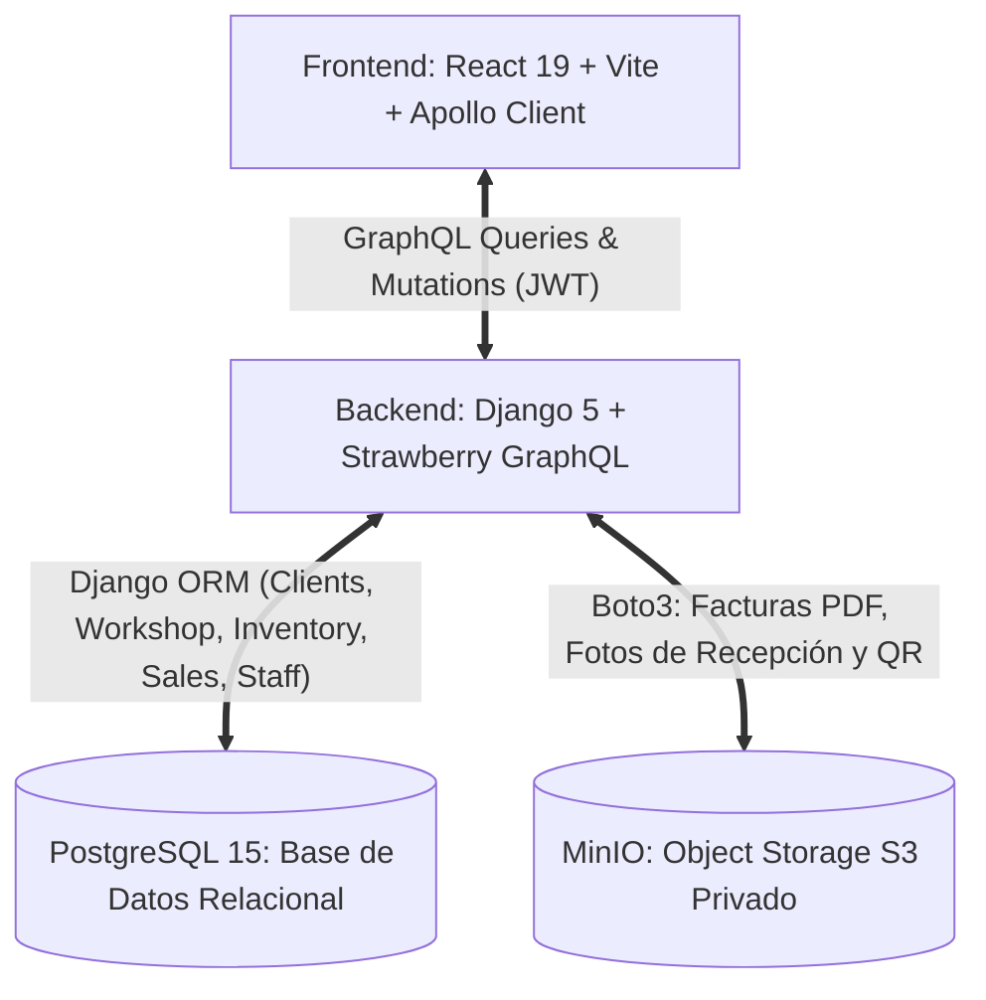

# PhoneFix - Documentación Oficial del Proyecto

Bienvenido a la documentación técnica y funcional de **PhoneFix** (proyecto `proyectoPF`). Este repositorio contiene un sistema web integral diseñado para la gestión operativa, técnica y comercial de talleres de servicio técnico de telefonía móvil y tiendas de repuestos/accesorios.

El proyecto ha sido **completamente reactivado, implementado y conectado de extremo a extremo**: el backend Django 5 con Strawberry GraphQL, la base de datos PostgreSQL 15, el almacenamiento de objetos S3 en MinIO y el frontend en React 19 operan de forma 100% integrada, sin datos simulados (mocks) y con auditoría contable inmutable.

---

## 📚 Índice de Documentación

| Documento | Descripción | Estado |
| :--- | :--- | :---: |
| [**01. Modelo de Negocio y Dominio**](./01_MODELO_DE_NEGOCIO.md) | Visión del producto, actores, roles (`ADMIN` vs `STAFF`), flujos de trabajo (Recepción, 4 fases de taller, POS, Arqueo de Caja y Libro Contable). | ✅ Actualizado |
| [**02. Arquitectura y Tecnologías**](./02_ARQUITECTURA_Y_TECNOLOGIAS.md) | Diagrama general de arquitectura, stack tecnológico (Django 5, Strawberry GraphQL, React 19, Tailwind v4, Apollo Client, PostgreSQL 15, MinIO S3, Docker). | ✅ Actualizado |
| [**03. Estructura del Repositorio**](./03_ESTRUCTURA_DEL_PROYECTO.md) | Desglose exhaustivo del árbol de carpetas de Backend y Frontend, módulos Django y componentes de React. | ✅ Actualizado |
| [**04. Situación Actual y Diagnóstico**](./04_SITUACION_ACTUAL_Y_DIAGNOSTICO.md) | Radiografía técnica del código: estado de conexión completa, resolución de deudas técnicas y fin de los mocks. | ✅ Actualizado |
| [**05. Roadmap y Plan de Reactivación**](./05_ROADMAP_Y_PLAN_DE_REACTIVACION.md) | Plan de acción histórico con todas las fases marcadas como completadas. | ✅ Completado |
| [**06. Guía de Ejecución y Despliegue**](./06_GUIA_DE_EJECUCION_Y_DESPLIEGUE.md) | Instrucciones para levantar el proyecto con Docker Compose en local o VPS (`docker compose up -d --build`). | ✅ Actualizado |
| [**07. Estructura de Permisos (RBAC)**](./07_ESTRUCTURA_PERMISOS_RBAC.md) | Modelo dinámico de roles y permisos RBAC implementado en Django, Strawberry GraphQL y React 19. | ✅ Implementado |
| [**08. Diseño Frontend y UI/UX**](./08_DISENO_FRONTEND_Y_UI_UX.md) | Sistema de diseño oficial Cyber-Clean (Negro `#080B11`, Cian `#00E5FF`, Esmeralda, Ámbar), pantallas completas y responsividad. | ✅ Implementado |
| [**09. Plan de Implementación de Mejoras**](./09_PLAN_IMPLEMENTACION_MEJORAS.md) | Mejoras críticas: Proveedores/Casetas, cotización diferida, comprobantes MinIO PDF y auditoría de abandono. | ✅ Completado |
| [**10. Flujo Integral de Taller y Libro Contable**](./10_PLAN_FLUJO_TALLER_Y_LIBRO_CONTABLE.md) | Especificación de las 4 fases de taller, techo presupuestario (Budget Cap), clientes recurrentes y libro contable bicanal. | ✅ Completado |
| [**11. Guía Visual del Usuario: Libro Contable**](./11_GUIA_USUARIO_LIBRO_CONTABLE.md) | Manual interactivo para el usuario explicando cada tarjeta KPI, filtro, badge de operación y columna del Libro Contable General. | ✅ Documentado |

---

## ⚡ Resumen Ejecutivo del Estado del Sistema

* **Frontend:** Totalmente conectado a la API GraphQL. Interfaz visual Cyber-Clean con modo oscuro premium, soporte para bloqueo de patrón de 9 puntos, modales contextuales, impresión de comprobantes en PDF y notificaciones en tiempo real.
* **Backend:** Modelos completos en PostgreSQL para Clientes, Dispositivos, Órdenes de Reparación, Proveedores/Casetas, Inventario, Ventas POS, Cierres de Caja y Libro Contable Inmutable.
* **Almacenamiento S3:** Generación automática de comprobantes de servicio en PDF con ReportLab almacenados en MinIO S3 (`phonefix-media`) con URLs presignadas.
* **Infraestructura:** Orquestación limpia mediante Docker Compose (`docker compose up -d --build`) con 4 contenedores activos (`backend_pfix`, `frontend_pfix`, `db_pfix`, `minio_pfix`).
